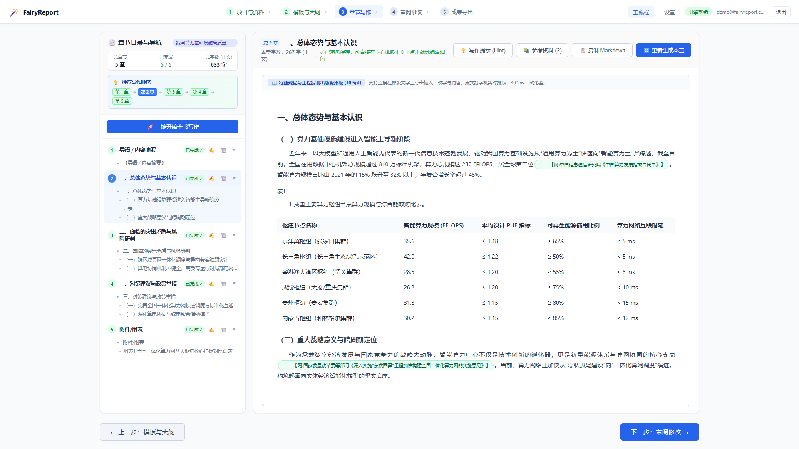
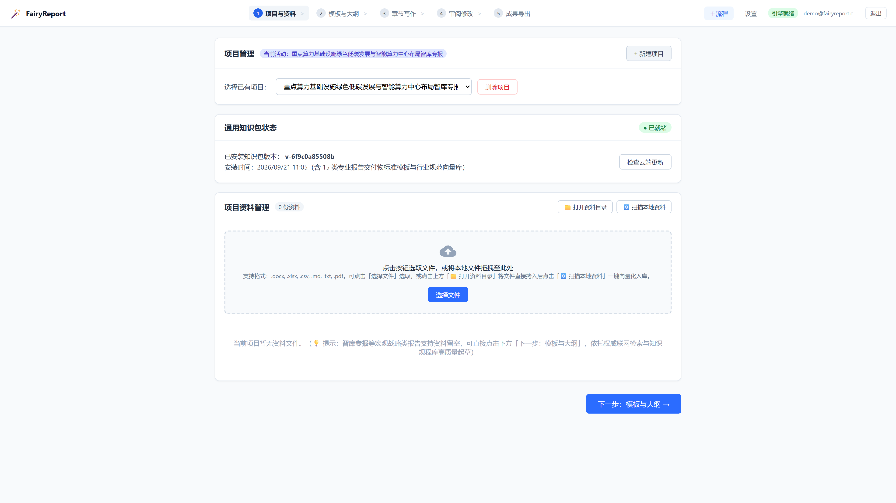
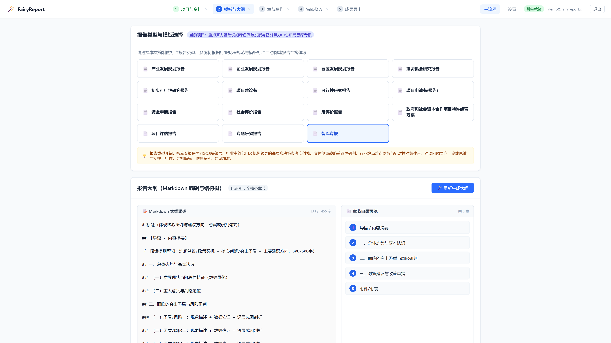
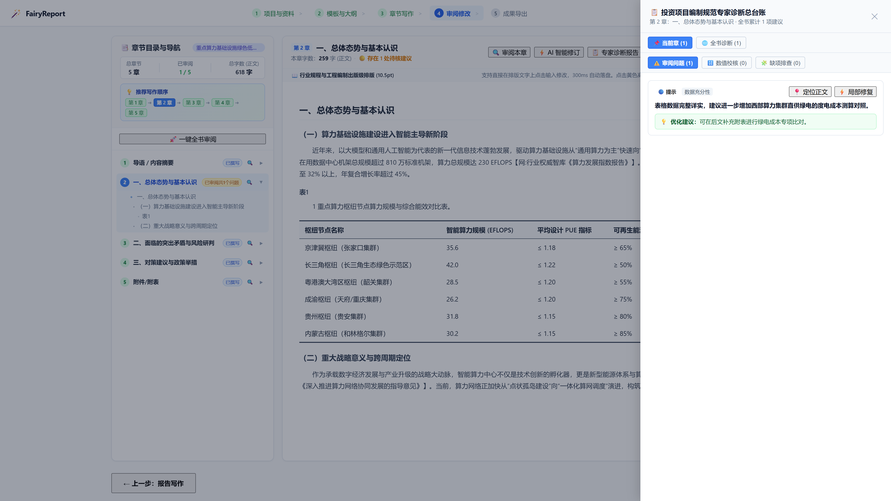
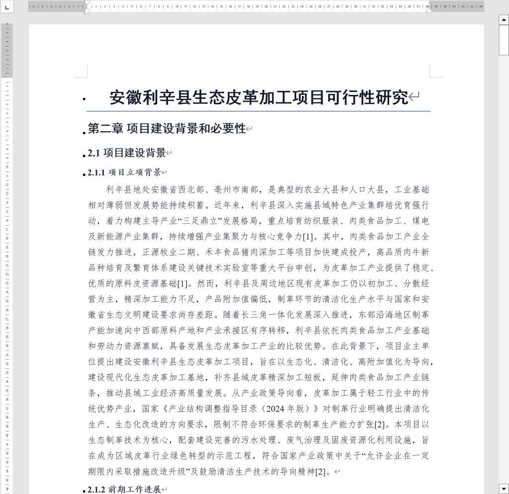

<div align="center">


# FairyReport 🧚‍♂️

**面向工程咨询、投资立项与智库研究的本地优先 AI 报告工作台 & MCP 工具链**  
*Local-First Structured Consulting & Engineering Report Workbench + MCP Server*

[](LICENSE)
[](desktop/)
[](engine/)
[](docs/MCP_GUIDE.md)
[](http://101.42.9.223/download)

[**简体中文**](README.md) | [**English**](README_EN.md) | [**🌐 国内官方网站**](http://101.42.9.223/) | [**📦 绿色免安装版下载**](http://101.42.9.223/download) | [**🔌 MCP 接入指南**](docs/MCP_GUIDE.md) | [**📖 快速上手指南**](docs/BEGINNER_GUIDE.md)

</div>

---

## ✨ 为什么选择 FairyReport？

用通用聊天大模型（ChatGPT / Claude / DeepSeek 网页端）直接写 **可行性研究报告、项目建议书、资金申请报告、特许经营方案** 等数万字专业报告时，通常会遇到 **四大致命痛点**：

1. **不懂行业法定大纲与规程**：章节结构随意发挥，遗漏发改/行业规定的必填论证项与财务比选表；
2. **幻觉捏造与虚假引用**：凭空编造政策文号、技术标准和工程参数，无法溯源核查；
3. **跨章节财务与工程指标前后打架**：第一章写“总投资 1.2 亿元”，第七章写“总投资 10,500 万元”，人工核对极其痛苦；
4. **Word 排版灾难**：Markdown 粘进 Word 后标题正文粘连、没有标准三线表、参考文献编号错乱。

**FairyReport** 通过 **“独立桌面工作台（Tauri 2）” + “标准 MCP Server（可被任意桌面端 AI Agent 调用）”** 双形态，提供从底稿建库、骨架锁定撰文、跨章节量纲自洽核验到出版级 Word（`.docx`）导出的端到端闭环：



---

## 🚀 两种使用方式（任选其一，或协同使用）

### 方式一：Windows 绿色免安装桌面端（适合工程咨询师、规划与研究人员）

无需配置 Python / Node 环境、**免注册免登录**、纯本地存储（支持放进移动硬盘随身携带）：

| 下载渠道 | 获取链接 | 提取码 / 说明 | 包体大小 |
| :--- | :--- | :--- | :--- |
| **🌐 国内官方网站下载页** | [http://101.42.9.223/download](http://101.42.9.223/download) | 腾讯云国内直连，含 SHA-256 校验码与图文指引 | `407 MB` |
| **☁️ 百度网盘** | [点击下载 FairyReport-Local-v1.6.5-Windows-x64.zip](https://pan.baidu.com/s/1IroAZAqSjjhP2hbhPoI7ZA?pwd=t8ii) | 提取码：`t8ii` | `407 MB` |
| **⚡ 夸克网盘** | [点击下载 FairyReport-Local-v1.6.5-Windows-x64.zip](https://pan.quark.cn/s/e5c9d5a33c8c) | 免提取码（直连） | `407 MB` |

> **三步即用**：① 解压压缩包到任意目录 ➔ ② 双击 `FairyReport.exe` ➔ ③ 右上角「设置」填入你自己的大模型 API Key（原生支持 **DeepSeek、通义千问、Kimi、硅基流动** 及 **OpenAI、Claude、Gemini、OpenRouter**）即可开始编制。

---

### 方式二：作为 MCP Server 接入主流桌面端 AI Agent（零额外 API Key）

如果你平时常驻 **Cherry Studio、Claude Desktop（含 Cowork）、Trae、Cursor、Windsurf、Antigravity、OpenClaw / QClaw、ChatWise** 等桌面端 Agent，无需单独配 Key，即可将 FairyReport 的 **15 类权威报告蓝图、三源深度 RAG、跨章节数值自洽核验、出版级三线表 Word 导出** 直接挂载给客户端里现有的大模型调用！

在客户端的 `mcpServers` 配置文件中添加（**方式 A：Windows 绿色便携包零 Python 环境直接挂载**；或 **方式 B：开发者源码挂载**）：

```json
{
  "mcpServers": {
    "fairyreport": {
      "command": "D:/Tools/FairyReport/fairyreport-engine.exe",
      "args": ["--mcp"]
    }
  }
}
```

<details>
<summary>开发者从源码挂载配置（macOS / Linux / Python 虚拟环境）</summary>

```json
{
  "mcpServers": {
    "fairyreport": {
      "command": "python",
      "args": ["-m", "engine.mcp_server"],
      "cwd": "D:/Repo/FairyReport"
    }
  }
}
```

</details>

*(支持 `uvx` / 虚拟环境启动及 Streamable HTTP 模式，完整客户端配置与对话指令详见 **[🔌 FairyReport MCP 接入指南 (docs/MCP_GUIDE.md)](docs/MCP_GUIDE.md)**。)*

| MCP 工具名称 | 是否需要额外 LLM Key | 核心能力说明 |
| :--- | :---: | :--- |
| `list_report_templates` | **否（零 Key）** | 列出 15 类专业报告模板、总字数上限、推荐写作顺序及拓扑理由 |
| `get_report_blueprint` | **否（零 Key）** | 获取指定报告的标准章节大纲骨架、各章字数配额与 12 项三线表写作规范 |
| `ingest_project_materials` | **否（零 Key）** | 将本地 PDF / Word / Excel / TXT 工程底稿切片并建立本地 ChromaDB 向量库 |
| `retrieve_report_evidence` | **否（零 Key）** | 执行三源深度 RAG（底稿 `【源:...】` + 国标 `【标:...】` + 免 Key 权威联网 `【网:...】`） |
| `verify_report_consistency` | **否（零 Key）** | 跨章节核验总投资、用地、建筑面积、工期、FIRR、营业收入量纲一致性与引用断链 |
| `export_consulting_docx` | **否（零 Key）** | 一键编译带封面、自动目录、标准三线表、标题防粘连与 `[1][2]` 参考文献的 `.docx` |
| `draft_chapter_with_engine` | 可选（配 `.env`） | 将超长工程章节卸载给本地引擎配置的低成本模型（如 DeepSeek）后台生成 |

---

## 🖥️ 五步全流程工作台实机预览

| Step 1 项目资料建库 | Step 2 规范大纲拟定 |
| :---: | :---: |
|  |  |
| 多格式工程底稿（PDF/Word/Excel/TXT）上传解析与本地向量化入库 | 15 类标准报告网格选择、定位说明与交互式多级大纲骨架锁定 |

| Step 3 章节流式撰写与三线表实时排版 | Step 4 专家多维审阅与单项销号 |
| :---: | :---: |
|  |  |
| 骨架锁定流式撰文、绿色溯源胶囊（`【源/标/网】`）与标准工程经济三线表 | 5 种审阅模式、4 态章节徽标流转、段落级外科手术式精准修订销号 |

| Step 5 跨章节指标自洽核验与出版级 Word 导出 |
| :---: |
|  |
| 自动跨章节经济技术指标交叉核验、参考文献按序编号与出版级 Word（`.docx`）/ Markdown 一键导出 |

---

## 📋 内置支持的 15 类主流专业报告交付物

FairyReport 内置权威标准大纲体系与 15 类专业报告模板知识库（位于 `generic_knowledge/templates/` 与 `pattern/`，开箱即用）：

1. **可行性研究报告**（含行业通用编制大纲标准范式，目标 50,000 字）
2. **初步可行性研究报告**（预可行性研究）
3. **项目建议书**（立项申报）
4. **资金申请报告**（专项债、政府扶持专项投资、政策性金融工具）
5. **项目申请书(报告)**（企业投资核准类项目）
6. **政府和社会资本合作项目特许经营方案**（特许经营 / PPP 方案）
7. **项目评估报告**（第三方独立再论证与复核）
8. **投资机会研究报告**（产业与项目投资机会鉴别）
9. **后评价报告**（全流程回顾与综合效益评价）
10. **社会评价报告**（利益相关者与社会互适性评估）
11. **产业发展规划报告**（产业定位、技术路线与空间布局）
12. **企业发展规划报告**（战略愿景、业务布局与资源保障）
13. **园区发展规划报告**（空间规划、产城融合与基础设施）
14. **专题研究报告**（重大工程关键技术与专项课题论证）
15. **智库专报**（高层决策参考、战略前瞻与对策建言）

---

## 🛠️ 核心技术架构与差异化亮点

### 1. 🔍 三源深度 RAG 检索融合体系
- **工程底稿向量库（`【源:文件名】`）**：自动解析项目地质勘探、立项批复、技术方案等本地底稿，离线向量化持久化；
- **行业规程标准库（`【标:标准全称】`）**：支持通用技术标准（GB / GB-T）、行业规范、环保节能与产业投资政策匹配；
- **百度免 Key 权威联网检索（`【网:标题】`）**：高可用公网免 Key 检索（百度优先调度，Bing / DuckDuckGo 备用），内置自媒体黑名单拦截，优先采信发改、工信、统计局及权威智库公示信息。

### 2. ⚖️ 跨章节工程经济指标自洽性核验引擎（`context_verifier.py`）
- 自动跨章节抽取 **总投资、建设用地、总建筑面积、建设工期、财务内部收益率（FIRR）、资本金内部收益率、达产年营业收入** 等核心量纲指标；
- 支持 **跨单位自动换算比对**（如前文写 `1.2 亿元` 与后文 `12,000 万元` 自动识别为一致，`2 年` 与 `24 个月` 自动对齐），并智能区分“本项目基准估算”与“敏感性分析/地方储备库引用”，精准揪出真正的前后数值冲突。

### 3. 📄 出版级 Word（`.docx`）排版与清洗编译器（`docx_builder.py`）
- **12 项规定动作标准三线表**：主要技术经济指标、场址比选、工艺路线比选、设备清单、投资估算、财务评价、风险矩阵等自动编译为规范三线表；
- **多级标题粘连智能拆分**：基于 50+ 种工程技术特征词与公文序号规则，自动切分大模型常见的“标题与正文连写”顽疾，100% 映射为 Word 原生 `Heading` 样式；
- **学术级参考文献重编号**：全书所有 `【源:...】【标:...】【网:...】` 按首次出现顺序统一编号为 `[1]`, `[2]`, `[3]...`，文末自动生成标准《参考文献》章（联网文献 100% 保留原始 URL）。

| 模块 | 技术选型 | 说明 |
| :--- | :--- | :--- |
| **桌面壳层** | **Tauri 2 (Rust)** | 轻量、跨平台、极速原生桌面体验 |
| **前端界面** | **Vue 3 + TypeScript + Vite + Pinia** | 组件化架构、响应式状态管理、Diff 视图与实时排版 |
| **后端与 MCP 引擎** | **Python 3.10+ / FastAPI / Official MCP SDK** | 同时支持桌面 HTTP/SSE 流式接口与标准 MCP `stdio` / `streamable-http` 协议 |
| **向量数据库** | **ChromaDB + FastEmbed + SQLite** | 纯本地离线持久化存储，保护企业与涉密工程数据隐私安全 |
| **大模型集成** | **国内外多厂商自适应客户端** | 原生支持 DeepSeek（V4 / Flash）、通义千问 Qwen、Kimi、硅基流动，以及 OpenAI GPT 系列、Anthropic Claude、Google Gemini、OpenRouter |
| **文档编译** | **python-docx / openpyxl** | 出版级封面、目录、样式映射与标准三线表自动构建 |

---

## 💻 开发者从源码快速启动

### 1. 环境准备与依赖安装

- **Node.js**：`>= 18.0.0`
- **Python**：`>= 3.10`
- **Rust**（仅编译 Tauri 桌面安装包时需要）：`cargo >= 1.75`

```bash
# 1. 创建并激活 Python 虚拟环境
python -m venv .venv
# Windows:
.venv\Scripts\activate
# Linux / macOS:
source .venv/bin/activate

# 2. 安装后端与 MCP 引擎依赖
pip install -r requirements.txt

# 3. 安装前端桌面依赖
cd desktop && npm install && cd ..
```

### 2. 启动运行

#### 模式 A：启动本地 Web / 桌面开发工作台
```bash
# 终端 1：启动本地 Python 后端引擎服务
python -m uvicorn engine.app.main:app --host 127.0.0.1 --port 8001

# 终端 2（浏览器极速开发模式，无需 Rust）：
cd desktop && npm run dev
# 访问 http://localhost:5173

# 或 终端 2（Tauri 2 原生桌面窗口模式）：
cd desktop && npm run tauri dev
```

#### 模式 B：启动 MCP Server
```bash
# 标准 STDIO 模式（供 Cherry Studio / Claude Desktop / Cursor / Trae 挂载）
python -m engine.mcp_server

# Streamable HTTP 模式（监听 127.0.0.1:8002）
python -m engine.mcp_server --transport streamable-http --port 8002
```

### 3. 全量质量门禁验证

仓库配备一条命令的 5 项全量门禁脚本（前端单测、Vue 类型检查、前端构建、后端与 MCP 全量 Pytest、Rust 壳层编译检查）：

```powershell
powershell -NoProfile -File scripts\verify.ps1
```

---

## 📖 文档与指南导航

- 🌐 **[国内官方网站与完整在线手册 (http://101.42.9.223/)](http://101.42.9.223/)**
- 🔌 **[MCP Server 多客户端接入指南 (docs/MCP_GUIDE.md)](docs/MCP_GUIDE.md)**（Cherry Studio / Claude Desktop / Trae / Cursor / OpenClaw）
- 📖 **[快速上手操作指南 (docs/BEGINNER_GUIDE.md)](docs/BEGINNER_GUIDE.md)**
- 📘 **[用户操作详细手册 (docs/USER_GUIDE.md)](docs/USER_GUIDE.md)**

---

## 🔒 数据安全与隐私承诺

- **纯本地持久化**：所有上传的工程底稿、向量索引和生成报告均存储于本地 `data/` 目录，绝不上传至任何第三方云端；
- **凭据零泄露**：API 密钥仅保存在本地客户端或本地 `.env` 中，严禁任何形式的日志打印或远端上传；
- **全异常静默熔断**：外部检索超时或网络抖动时自动降级，绝不阻塞报告编写主流程。

---

## 📄 开源许可证

本项目基于 [MIT License](LICENSE) 开源。如果 FairyReport 对你的报告编制或 Agent 工作流有帮助，欢迎点亮一颗 **Star ⭐** 支持我们！
