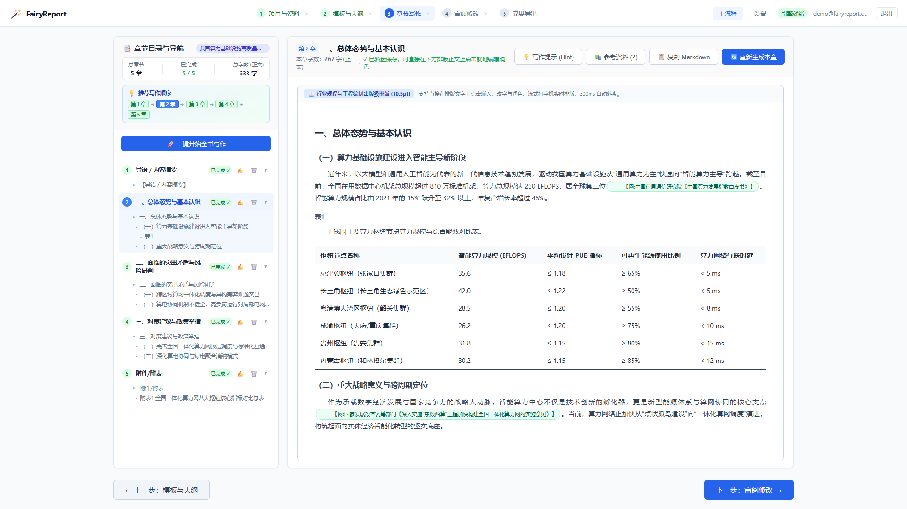
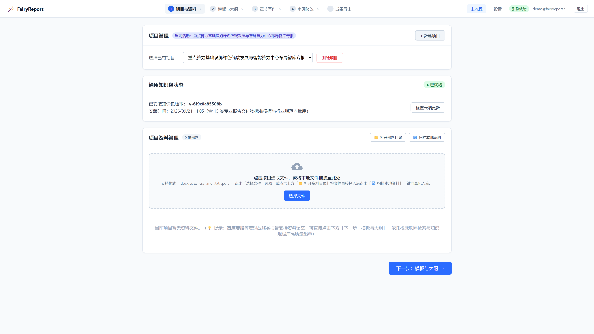
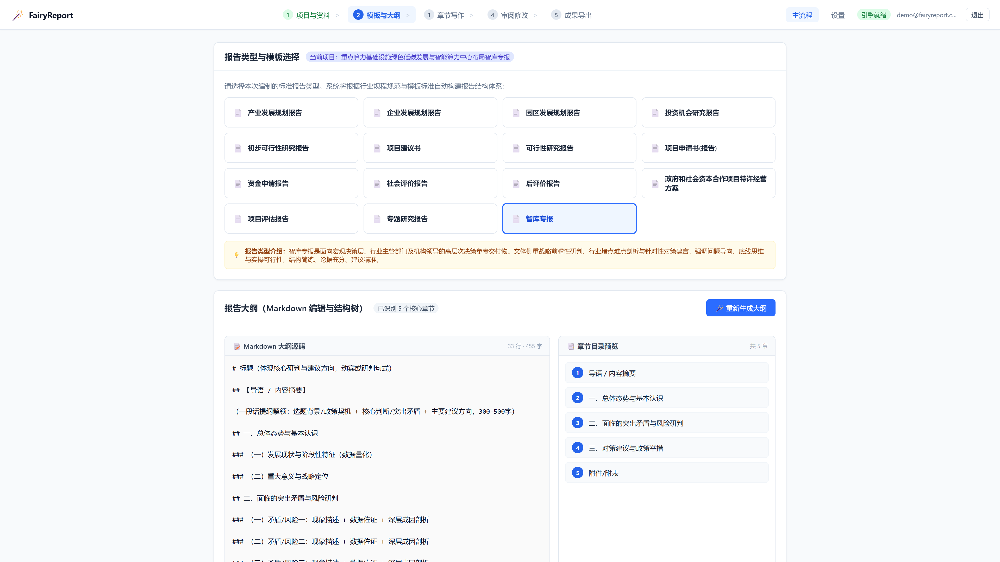
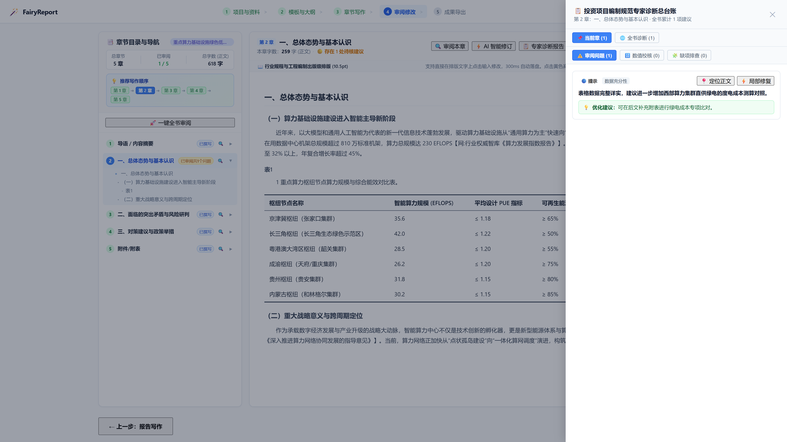
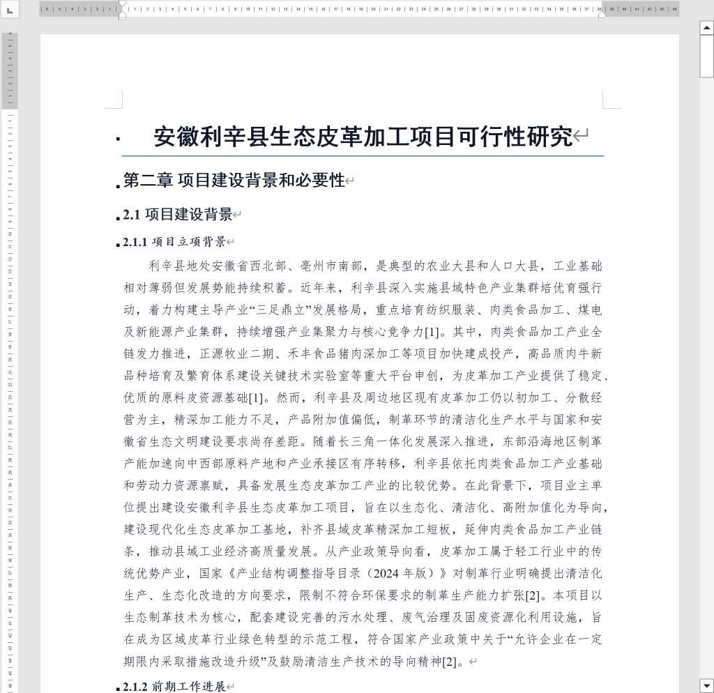

<div align="center">


# FairyReport 🧚‍♂️

**Local-First Structured Consulting & Engineering Report Workbench + MCP Server**  
*Built with Tauri 2, Vue 3, FastAPI, 3-Source RAG, Cross-Chapter Numerical Verification, and Publication-Grade DOCX Export*

[](LICENSE)
[](desktop/)
[](engine/)
[](docs/MCP_GUIDE.md)
[](https://www.modelscope.cn/mcp/servers/atalanta0505/FairyReport)
[](https://glama.ai/mcp/servers/atalanta0505/FairyReport)
[](http://101.42.9.223/download)

[**简体中文**](README.md) | [**English**](README_EN.md) | [**🌐 Official Website**](http://101.42.9.223/) | [**📦 Portable Download**](http://101.42.9.223/download) | [**🧩 ModelScope MCP**](https://www.modelscope.cn/mcp/servers/atalanta0505/FairyReport) | [**🔌 MCP Integration Guide**](docs/MCP_GUIDE.md) | [**📖 Beginner Guide**](docs/BEGINNER_GUIDE.md)

</div>

> [!NOTE]
> **Language & LLM Compatibility Scope**
> - **UI & Built-in Regulatory Templates**: The desktop workbench interface and all 15 built-in report templates (Feasibility Study, Project Proposal, Special Bond Application, PPP Scheme, etc.) are currently in **Simplified Chinese**, specifically engineered around Chinese engineering consulting and NDRC / GB-T regulatory standards.
> - **Domestic & International LLM Keys**: Both the Desktop Workbench and Engine natively support **DeepSeek, Qwen, Moonshot/Kimi, SiliconFlow**, as well as **OpenAI GPT series, Anthropic Claude (native `/v1/messages` API), Google Gemini, and OpenRouter** with automatic `/v1` path resolution and provider-level parameter adaptation. In **MCP Server Mode**, zero extra API keys are required — your host client (Claude Desktop, Cursor, Cherry Studio, Trae) uses its own configured model.

---

## ✨ Why FairyReport?

Drafting 30,000–50,000 word consulting, engineering, and investment reports (Feasibility Studies, Project Proposals, Special Bond Applications, PPP Schemes, Industrial Planning, Think-Tank Briefs) with generic chat LLMs fails in four predictable ways:

1. **Structural Drift**: Generic chat agents lose track of mandatory regulatory section skeletons and required engineering/financial comparison tables.
2. **Hallucinated Citations**: Unverifiable policy numbers, technical standards, and fabricated data sources.
3. **Cross-Chapter Numerical Contradictions**: Chapter 1 states *"Total Investment: 120M CNY"* while Chapter 7 states *"Total Investment: 105M CNY"*.
4. **Broken Word Formatting**: Pasting raw Markdown into Word results in glued headings, ugly tables instead of formal academic/engineering three-line tables, and unindexed bibliographies.

**FairyReport** solves this in two ways:
- **A Standalone Local-First Desktop Workbench** (`Tauri 2 + Vue 3 + FastAPI`) with a guided 5-step pipeline;
- **A Zero-LLM-Key MCP Server** (`engine.mcp_server`) that equips **Claude Desktop, Cherry Studio, Cursor, Trae, Windsurf, Antigravity, and OpenClaw** with authoritative report blueprints, 3-source RAG, deterministic cross-chapter numerical verification, and publication-grade `.docx` compilation.



---

## 🔌 Use FairyReport as an MCP Server (Zero Extra API Key Required)

When connected to your favorite desktop AI Agent, FairyReport operates in **Host-LLM Mode** by default: your desktop client's existing LLM handles reasoning and prose generation, while FairyReport provides deterministic tools that general-purpose agents lack.

Add this to your client's `mcpServers` config (`claude_desktop_config.json`, Cherry Studio, Cursor, Trae, etc.) — either **zero-Python via the Windows Portable package** or **from source**:

```json
{
  "mcpServers": {
    "fairyreport": {
      "command": "D:/Tools/FairyReport/fairyreport-engine.exe",
      "args": ["--mcp"]
    }
  }
}
```

<details>
<summary>Run from source (Python / macOS / Linux)</summary>

```json
{
  "mcpServers": {
    "fairyreport": {
      "command": "python",
      "args": ["-m", "engine.mcp_server"],
      "cwd": "D:/Repo/FairyReport"
    }
  }
}
```

</details>

<details>
<summary>Run directly via uvx (zero clone required)</summary>

```json
{
  "mcpServers": {
    "fairyreport": {
      "command": "uvx",
      "args": ["--from", "git+https://github.com/atalanta0505/FairyReport.git", "fairyreport-mcp"]
    }
  }
}
```

</details>

| MCP Tool | Requires Extra LLM Key? | Capability |
| :--- | :---: | :--- |
| `list_report_templates` | **No** | Lists all 15 built-in consulting/engineering report templates, word budgets, and topological writing orders |
| `get_report_blueprint` | **No** | Returns the locked section skeleton (`outline_md`), per-chapter word budgets, and 12 mandatory three-line table specifications |
| `ingest_project_materials` | **No** | Parses and indexes local `.pdf`, `.docx`, `.xlsx`, `.txt`, and `.md` project working papers into local ChromaDB |
| `retrieve_report_evidence` | **No** | Runs 3-source RAG: local project files (`【源:...】`), industry standards (`【标:...】`), and key-free authoritative web search (`【网:...】`) |
| `verify_report_consistency` | **No** | Cross-checks key engineering/financial metrics (Total Investment, Land Area, Floor Area, Duration, FIRR, Revenue) across chapters with unit normalization |
| `export_consulting_docx` | **No** | Compiles multi-chapter Markdown into a publication-grade `.docx` with cover page, TOC, three-line tables, unglued headings, and ordered `[1][2]` bibliography |
| `draft_chapter_with_engine` | Optional (`.env`) | Offloads ultra-long single-chapter drafting to a configured local/cost-efficient OpenAI-compatible endpoint (e.g., DeepSeek) |

Also listed on **[🧩 ModelScope MCP Plaza (FairyReport)](https://www.modelscope.cn/mcp/servers/atalanta0505/FairyReport)**. See **[docs/MCP_GUIDE.md](docs/MCP_GUIDE.md)** for full step-by-step setup across Cherry Studio, Claude Desktop, Trae, Cursor, and OpenClaw.

---

## 🖥️ 5-Step Desktop Workbench Tour

| Step 1: Local Knowledge Base | Step 2: Blueprint & Skeleton Lock |
| :---: | :---: |
|  |  |
| Parse & vectorize local PDF, Word, Excel, and TXT engineering documents offline | Choose from 15 authoritative report templates with topological writing order |

| Step 3: Streaming Drafting & Three-Line Tables | Step 4: Multi-Mode Expert Review & Surgical Revision |
| :---: | :---: |
|  |  |
| Skeleton-locked streaming generation, inline green citation pills, and standard three-line tables | 5 diagnostic modes, 4-state chapter badges, and paragraph-level issue resolution |

| Step 5: Cross-Chapter Verification & Publication DOCX Export |
| :---: |
|  |
| Automated cross-chapter numerical consistency checks, ordered `[1][2]` bibliography, and one-click `.docx` export |

---

## 💻 Quick Start from Source

### 1. Prerequisites & Installation
- **Python**: `>= 3.10`
- **Node.js**: `>= 18.0.0`
- **Rust** (only required if building the Tauri native binary): `cargo >= 1.75`

```bash
# 1. Create and activate virtual environment
python -m venv .venv
# Windows:
.venv\Scripts\activate
# Linux / macOS:
source .venv/bin/activate

# 2. Install Python engine & MCP dependencies
pip install -r requirements.txt

# 3. Install frontend dependencies
cd desktop && npm install && cd ..
```

### 2. Run the Workbench or MCP Server

```bash
# Option A: Run Local FastAPI Engine + Web/Tauri Workbench
python -m uvicorn engine.app.main:app --host 127.0.0.1 --port 8001
# In a second terminal:
cd desktop && npm run dev

# Option B: Run as an MCP Server (stdio or streamable-http)
python -m engine.mcp_server
# Or over HTTP:
python -m engine.mcp_server --transport streamable-http --port 8002
```

### 3. Run the Full Verification Suite

```powershell
powershell -NoProfile -File scripts\verify.ps1
```

---

## 📄 License

Released under the [MIT License](LICENSE). If FairyReport helps your consulting or AI Agent workflow, please consider giving the repository a **Star ⭐**!
