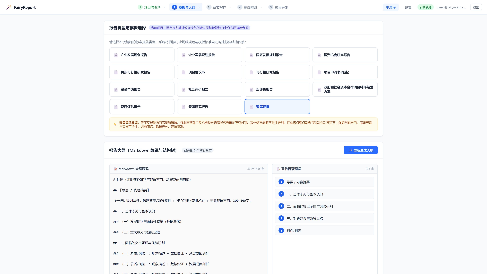
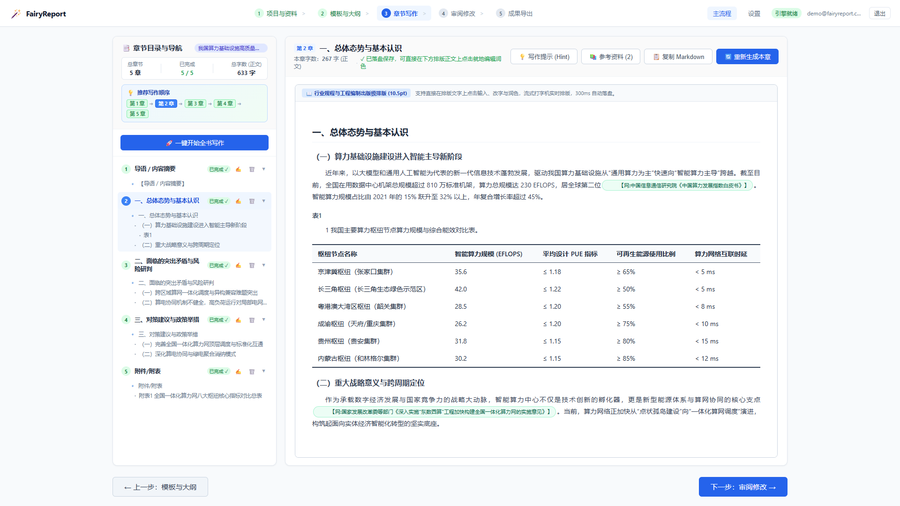
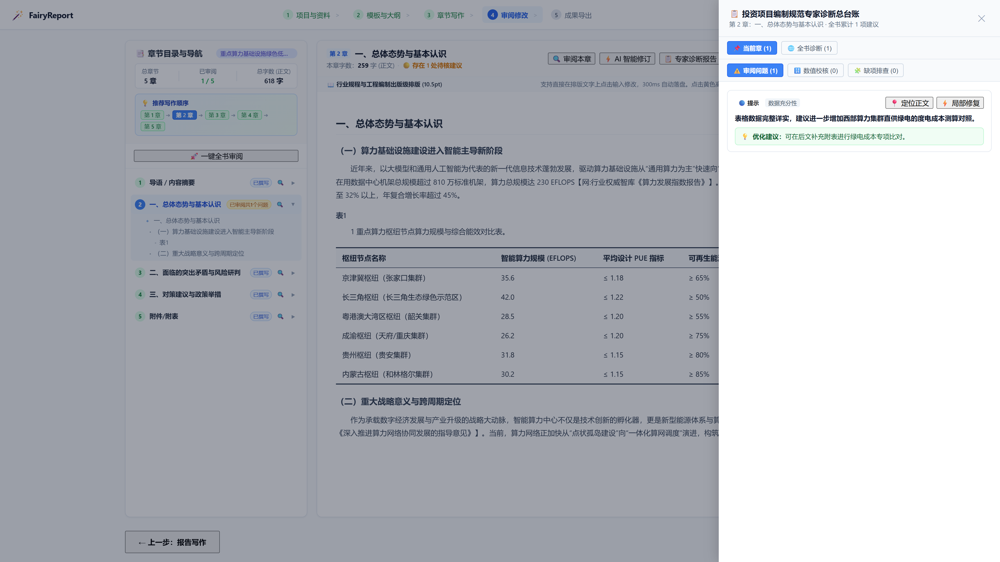
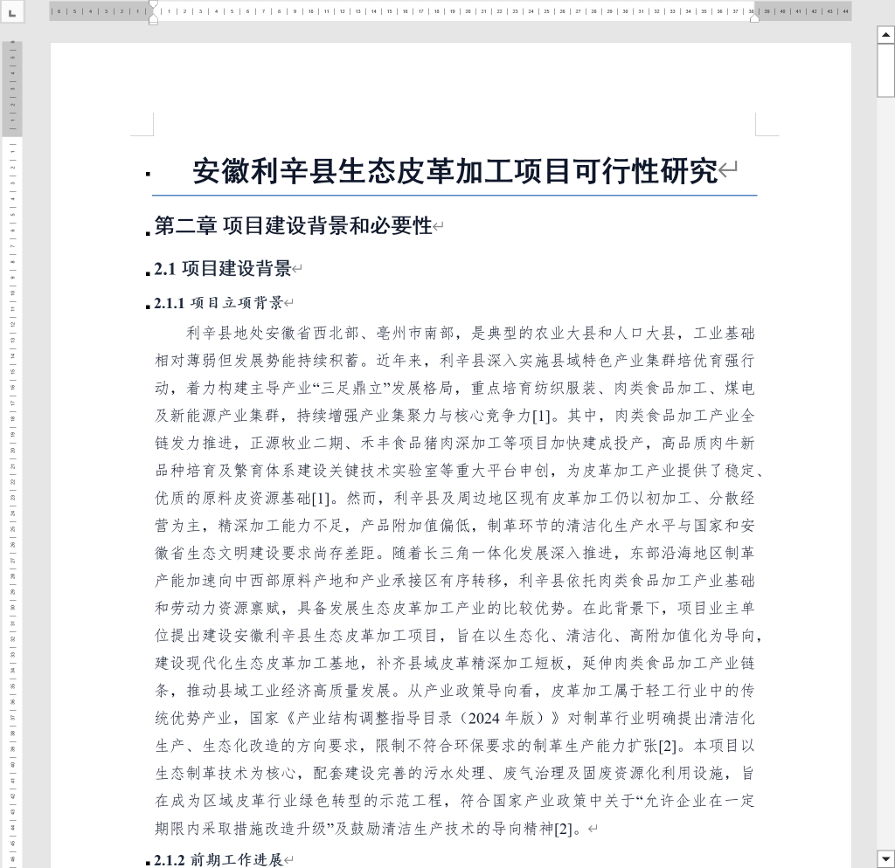

# FairyReport 智能报告编制应用 —— 快速上手操作指南

> **版本**：v1.6.5  
> **适用对象**：初次使用本系统或从事投资项目与工程报告编制的业务人员  
> **编写目的**：直观演示系统操作流程与功能架构，指导用户快速完成报告编制与成果导出；配图均为真实系统操作界面。

---

## 目录
- [【前言】系统定位与编制效能概述](#前言系统定位与编制效能概述)
- [【第一篇】快速入门与核心概念](#第一篇快速入门与核心概念)
- [【第二篇】五步全流程图文操作指引（附真实界面）](#第二篇五步全流程图文操作指引附真实界面)
  - [步骤 1：项目与资料 —— 资料留空，即开即写](#步骤-1项目与资料--资料留空即开即写)
  - [步骤 2：模板与大纲 —— 锁定智库专报标准骨架](#步骤-2模板与大纲--锁定智库专报标准骨架)
  - [步骤 3：章节写作 —— 边思索、边查证、自动绘表](#步骤-3章节写作--边思索边查证自动绘表)
  - [步骤 4：审阅修改 —— 专家诊断总台账逐项把关](#步骤-4审阅修改--专家诊断总台账逐项把关)
  - [步骤 5：成果导出 —— 综合自洽度 100 分一键交付](#步骤-5成果导出--综合自洽度-100-分一键交付)
- [【第三篇】日常使用常见问题解答（FAQ）](#第三篇日常使用常见问题解答faq)

---

## 【前言】系统定位与编制效能概述

在投资项目立项、可行性研究、技术方案编制与智库专报起草过程中，传统报告编制工作往往面临以下常见难点：
1. **资料繁杂且多源分散**：各类行业动态、统计数据与技术文档体量庞大，资料整理耗时较长；
2. **规范体例要求严密**：现行标准指南与行业规范对目录章节、数据前后一致性、专业表格样式均有明确规范，需严格遵循标准体例；
3. **初稿起草周期较长**：传统人工起草需耗费较长时间，且需反复复核文字口径与数据自洽性。

**FairyReport 智能报告编制应用** 专注于辅助工程咨询与投资项目报告编制全流程：
- **本地集成开箱即用**：后端计算引擎与本地向量库一体化打包，无需用户安装配置额外运行环境；
- **支持无前置资料直接起草**：对于智库专报等宏观战略类报告，可依托权威联网检索与内置通用规程库直接完成大纲推导与章节撰写；
- **来源引证全流程可追溯**：正文核心论据与数据均配备权威来源引用角标，支持回溯核验；
- **成果自动规范排版**：一键生成符合规范公文排版标准的 Word 初稿（`.docx`）与 Markdown（`.md`），便于后续研讨与交付使用。

---

## 【第一篇】快速入门与核心概念

### 1. 软件启动
- 下载绿色压缩包（如 `FairyReport-Local-v1.6.5-Windows-x64.zip`），解压至本地任意目录。
- 双击运行 **`FairyReport.exe`**。
- 软件在后台自动唤起本地独立计算引擎，无需注册或登录，直接进入五步编制主工作台。

### 2. 五步端到端工作流水线
系统界面采用端到端流程向导设计，包含以下 5 个标准化操作阶段：

---

## 【第二篇】五步全流程图文操作指引（附真实界面）

以下以编制《重点算力基础设施绿色低碳发展与智能算力中心布局智库专报》为例，说明全流程操作：

### 步骤 1：项目与资料 —— 资料留空直接起草
- **操作步骤**：点击“+ 新建项目”，输入报告名称；如有参考文档可直接拖拽导入，亦可保持留空直接创建。
- **系统执行**：系统自动完成项目初始化，并加载内置通用知识包（包含 15 类专业报告交付物标准模板与行业规程向量库）。
- **真实界面呈现**：

> **功能要点**：
> - **支持无前置资料模式**：界面提示“智库专报等宏观战略类报告支持资料留空，可直接点击下方「下一步：模板与大纲」，依托权威联网检索与知识规程库高质量起草”；
> - **流程衔接顺畅**：对于政策建言与智库分析类报告，无需导入复杂底稿，确认项目名称后即可直接进入大纲设计阶段。

---

### 步骤 2：模板与大纲 —— 锁定标准骨架
- **操作步骤**：在模板网格中选择“智库专报”卡片。
- **系统执行**：
  1. 呈现智库专报的业务定位说明与编制要点；
  2. 加载符合现行编制标准指南的 5 个核心章节大纲。
- **真实界面呈现**：

> **功能要点**：
> - **15 类标准模板库**：网格区域展示 15 类主流专业报告模板，卡片排布规范统一；
> - **业务定位说明**：选中模板后即时显示其业务定位：“智库专报是面向宏观决策层、行业管理机构及机构领导的高层次决策参考交付物。文体侧重战略前瞻性研判、行业堵点难点剖析与针对性对策建言，强调问题导向、底线思维与实操可行性，结构简练、论据充分、建议精准”；
> - **结构骨架锁定**：右侧加载 5 个核心章节（导语/摘要、总体态势、突出矛盾、对策建议、附件表），确保后续撰写要素完备。

> ⚠️ **智库专报注意**：这一类型支持**不导入资料直接起草**，但它的 5 章大纲推导方式与其他模板不同，**生成大纲往往比别人慢**，请耐心等它出结果，别反复点。

---

### 步骤 3：章节写作 —— 智能流式生成与规范排版
- **操作步骤**：点击“一键开始全书写作”，或针对特定章节单独点击起草。
- **系统执行**：
  1. 自动触发权威外部联网检索调取最新公开数据；
  2. 实时流式生成正文，并在段落中自动嵌入引用角标；
  3. 涉及技术指标或经济对比的内容，自动排版为标准工程三线表。
- **真实界面呈现**：

> **功能要点**：
> 1. **推荐写作顺序**：界面标明推荐编写路径，已完成撰写的章节在目录树中同步展示完成状态；
> 2. **规范工程三线表**：系统自动将算力枢纽节点的能效指标与算力规模排版为“顶线粗、底线粗、中线细”的标准工程三线表；
> 3. **精准引用角标**：正文自动标注 `【网:权威信息通信智库《算力发展指数报告》】` 与 `【网:主管部门指导意见《深入推进算力网络协同发展的指导意见》】` 等出处标签，论证过程具备可溯源性。

---

### 步骤 4：审阅修改 —— 多维专家规程质检
报告初稿完成后，系统提供多维度质量复核功能：
- **操作步骤**：进入审阅界面，点击右上角“专家诊断报告”。
- **系统执行**：
  1. 针对全篇或指定章节执行合规性、完整性与数据充分性审查；
  2. 目录树标注章节审查状态徽标；
  3. 展开“投资项目编制规范专家诊断总台账”抽屉，分类列出问题清单与修改建议。
- **真实界面呈现**：

> **功能要点**：
> - **问题台账清晰规范**：抽屉内清晰列出指标复核结果与补充建议（例如“建议进一步增加西部算力集群直供绿电的度电成本测算对照”）；
> - **支持定向局部修订**：支持“定位正文”跳转至对应段落，点击“局部修复”仅对该问题段落实施原位修改，保持整体篇章结构稳定。

> **初稿已经生成了，为什么还要审阅修改？** 
> 生成追求的是效率，出来的是"可行初稿"；审阅是让模型换成**挑刺的视角**，拿政策、标准、教材当尺子逐条核对。这两件事的注意力完全不一样，也是大模型领域公认的做法（先写、再验）。 
> 报告也没有"唯一最优解"：业主、审批部门、评审专家的关注点各不相同。审阅是帮你**快速发现盲区**，采纳与否、改不改，**始终由你（注册咨询工程师）说了算**。就像资深架构师的代码合并前也要跑静态扫描和单测一样。

---

### 步骤 5：成果导出 —— 自洽性核验与出版级交付
成果导出前，系统执行跨章节数据自洽性复核：
- **操作步骤**：进入导出页面，查看自洽度核验结果，点击“一键导出 Word 报告 (.docx)”。
- **系统执行**：
  1. 交叉比对全篇核心数据指标、引用出处链条与上下游逻辑脉络；
  2. 自动根据学术文献规范对全篇引用统一编号并生成参考文献列表；
  3. 输出排版标准的出版级 Word 初稿文件。
- **真实界面呈现**：

> **功能要点**：
> - **自洽性跨章节复核**：系统提示“综合自洽度 100 分，100% 吻合！全书跨章节核心指标完全吻合、引用链溯源清晰、上下游逻辑闭环”；
> - **参考文献自动排序**：页面列出按引用顺序统一编号的参考文献清单；
> - **规范初稿格式**：导出的 Word 文档涵盖规范封面、自动目录、标准层级标题与三线表格样式，满足正式交付与评审需求。

---

## 【第三篇】日常使用常见问题解答（FAQ）

#### Q1：智库专报是否必须导入项目资料文件？
**答**：智库专报聚焦宏观战略前瞻、行业堵点剖析与对策建议。FairyReport 内置行业通用编制指南，并具备权威联网检索能力。在未导入项目资料时，系统可依托内置规程与权威公开发布的研究报告、指导文件独立完成起草。

#### Q2：使用本系统是否需要编写大模型提示词？
**答**：无需用户编写提示词。系统已将行业标准规程、章节写作逻辑、三线表规范与格式约束固化为提示构建引擎。用户只需选择报告类型并确认大纲，系统即自动完成专业提示构建与 RAG 智识注入。

#### Q3：导出的 Word 文档是否支持后续二次编辑？
**答**：导出的成果为标准 `.docx` 格式文档，兼容 Microsoft Office Word 与 WPS Office 等主流办公软件。用户可在本地直接进行文字修订、格式调整或数据补充。

