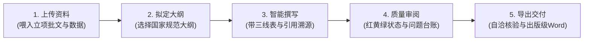

# FairyReport 智能报告写作平台 —— 新人极简图文上手指南与宣介底稿

> **版本**：v1.5.0  
> **适用受众**：零技术基础新手、初涉投资项目与工程技术报告编制的业务人员、宣介推广讲师  
> **设计目标**：无需任何开发或系统配置知识，5 分钟上手；图文素材可直接作为推介会演示 PPT 与宣传视频分镜脚本底稿。

---

## 目录
- [【前言】献给新手：你的 24 小时专业报告起草助理](#前言献给新手你的-24-小时专业报告起草助理)
- [【第一篇】零门槛极速上手（3 分钟掌握核心概念）](#第一篇零门槛极速上手3-分钟掌握核心概念)
- [【第二篇】五步全流程图文实操指南（附真实操作界面）](#第二篇五步全流程图文实操指南附真实操作界面)
  - [步骤 1：投喂资料 —— 把项目素材拖进来](#步骤-1投喂资料--把项目素材拖进来)
  - [步骤 2：选定大纲 —— 锁定专业目录骨架](#步骤-2选定大纲--锁定专业目录骨架)
  - [步骤 3：智能撰写 —— 边思索、边查证、边起草](#步骤-3智能撰写--边思索边查证边起草)
  - [步骤 4：专业审阅 —— 像资深总工一样逐段把关](#步骤-4专业审阅--像资深总工一样逐段把关)
  - [步骤 5：核验导出 —— 一键交付出版级 Word 初稿](#步骤-5核验导出--一键交付出版级-word-初稿)
- [【第三篇】新手日常使用常见疑问（FAQ）](#第三篇新手日常使用常见疑问faq)
- [【第四篇】推介会演示 PPT 逐页设计底稿（8 屏完整宣讲方案）](#第四篇推介会演示-ppt-逐页设计底稿8-屏完整宣讲方案)
- [【第五篇】宣传短视频极速分镜脚本（60 秒 / 2 分钟实拍版）](#第五篇宣传短视频极速分镜脚本60-秒--2-分钟实拍版)

---

## 【前言】献给新手：你的 24 小时专业报告起草助理

在投资项目立项、可行性研究、技术方案编制与智库专报撰写过程中，新人往往面临三大痛点：
1. **资料浩如烟海**：数十份批文、勘察报告、数据表格，不知从何梳理；
2. **格式规范严苛**：国家发改委与行业指南对目录章节、数据前后一致性、专业表格样式有极高标准，漏写一项就要推倒重来；
3. **初稿周期漫长**：从零码字往往耗费数周时间，还要反复修正错别字与口径偏差。

**FairyReport** 就是为你量身打造的“桌面级智能报告起草助手”：
- **不用敲任何代码，不用安装复杂数据库**，就像打开日常办公软件一样简单；
- **你给它资料，它按国家标准大纲写初稿**；
- 撰写过程看得见：哪句话引用了哪份文件的第几页、数据从何而来，全都清晰可查；
- 导出就是排版精美、字体行距符合规范的 **Word 初稿（.docx）**，立刻就能向上级或团队汇报讨论。

---

## 【第一篇】零门槛极速上手（3 分钟掌握核心概念）

### 1. 软件启动只需一步
- 下载绿色压缩包（如 `FairyReport-Local-v1.5.0-Windows-x64.zip`），解压到任意文件夹（如桌面或 D 盘）。
- 双击运行 **`启动 FairyReport.bat`**。
- 软件全自动在后台准备好智能引擎，并在桌面弹出优雅清爽的操作窗口。

### 2. 认识核心操作流水线
整个软件界面遵循最符合人类工作直觉的“流水线设计”，你只需沿着顶部的 5 个步骤一步步往下走：

---

## 【第二篇】五步全流程图文实操指南（附真实操作界面）

### 步骤 1：投喂资料 —— 把项目素材拖进来
- **你在做什么**：把项目涉及的前期规划、批复文件、现场勘察记录、Excel 投资估算表或技术方案说明等，直接拖进上传区域。
- **软件在做什么**：平台自动帮您把文本分段整理，建立检索索引。起草每一章时，AI 会先像专业研究人员一样，逐页去翻看您上传的文件，绝不胡编乱造。

---

### 步骤 2：选定大纲 —— 锁定专业目录骨架
- **你在做什么**：在左侧选择你本次需要起草的报告类型。
- **可选范畴**：涵盖投资项目可行性研究报告、项目建议书、资金申请报告、节能报告、社会稳定风险评估、智库专报等 12 类专业报告。
- **效果呈现**：

> **小白看点**：
> - 界面右侧会展示符合国家发改委最新指南的标准目录结构。
> - 软件严格执行**“目录骨架锁定”**：大纲一旦确定，AI 就必须按顺序写每一节，绝不会像普通聊天软件那样丢三落四或自行篡改章节标题。

---

### 步骤 3：智能撰写 —— 边思索、边查证、边起草
- **你在做什么**：点击“开始生成全篇”或点击某一章节单独起草。
- **效果呈现**：

> **小白看点**：
> 1. **深度思考流一目了然**：点击蓝色的“深度思考展开”，你能看到 AI 是如何逐步推导专业逻辑的，有理有据；
> 2. **国家标准三线工程表格**：系统自动将方案对比、经济指标排版为标准的三线表（顶线、底线粗，中线细），不用自己手动画表格；
> 3. **精准角标溯源**：正文中的每一个关键论据都会打上引用角标（如 `[1]`），点击即可高亮定位到原始文件具体段落。

---

### 步骤 4：专业审阅 —— 像资深总工一样逐段把关
初稿写完后，很多新手不知道写得质量如何。FairyReport 提供比人工初筛更严密的四维审阅机制：
- **完整性**：有没有漏掉发改委要求的关键内容？
- **一致性**：前文说的投资总额和后文表格对得上吗？
- **合规性**：用词是否规范、结构是否严密？
- **数据充分性**：论点是否有具体数据支撑？

#### 4.1 四色状态导航（看一眼就知道哪里需要关注）
在审阅界面的左侧目录，每一章都有明确的状态勋章：

- 🟢 **已通过**：内容详实合规，论据充分，可直接进入下一步；
- 🟡 **待优化**：有小瑕疵（如描述略简略或缺少部分细项），建议修改；
- 🔴 **不合格**：严重缺乏数据或内容偏离主题，必须重新生成；
- ⚪ **未生成 / 草稿**：尚未撰写或处于初始草稿阶段。

#### 4.2 问题台账与一键采纳修改
右侧提供智能问题清单，指出具体哪一句有问题并给出修改建议：

> **小白看点**：
> 发现问题时，点击“一键采纳修改”或“仅对本节重新起草”，系统只针对有问题的段落精准修改，绝不会破坏全篇其他写好的内容！

---

### 步骤 5：核验导出 —— 一键交付出版级 Word 初稿
在正式导出前，系统会触发自洽性核验机制：检查项目名称、建设规模、投资金额等核心要素在全篇数十页内容中是否完全一致。

- **绿灯亮起**：“自洽性核验通过”。
- **点击“导出 Word (.docx)”**：瞬间生成一份排版完整的项目报告初稿。封面、自动目录、三级标题字体字号、首行缩进、三线表排版全部内置做好，无需再为排版加班。

---

## 【第三篇】新手日常使用常见疑问（FAQ）

#### Q1：我完全不懂怎么给 AI 写提示词（Prompt），也能用好吗？
**答**：完全不需要写提示词！所有投资项目规范大纲、行业知识规程、格式约束已经全部固化在平台内部。你只需要“传资料、点大纲、点开始”，软件自动完成专业级的提示工程。

#### Q2：我上传的工程机密文件安全吗？
**答**：FairyReport 支持本地离线向量检索。数据文件全部保存在您自己电脑的本地文件夹中，不经过任何第三方云存储中转，保障商业秘密与工程数据安全。

#### Q3：如果 AI 写出来的数据和我的实际项目数据不一致怎么办？
**答**：
1. 可以在步骤 1 补充上传更详细的“投资测算表”或“工程指标表”；
2. 可以在步骤 4 的审阅界面，直接在右侧文本框里手动敲字修改；
3. 可以在步骤 5 导出 Word 后，在熟悉的微软 Word 软件中自由修改。

---

## 【第四篇】推介会演示 PPT 逐页设计底稿（8 屏完整宣讲方案）

> **适用场合**：技术交流推介会、项目宣讲会、新员工入职培训、产品立项汇报  
> **设计原则**：大图少字、场景代入、痛点直击、成果震撼。

---

### PPT 第 1 页：封面与开场
- **页面标题**：让专业报告起草告别低效加班
- **副标题**：FairyReport 智能报告写作平台（桌面端）推介汇报
- **主视觉构图**：简洁大气的科技蓝渐变背景，中央展示软件桌面端主界面悬浮透视图。
- **演说口播词**：
  > “各位领导、同事们大家好！在传统的项目前期准备中，撰写动辄上百页的可行性研究或项目方案，往往需要查阅大量资料、反复核验数据，耗时耗力。今天为大家介绍的 FairyReport，是一款真正懂业务、懂规范的桌面级智能助手。无需复杂学习，5 分钟即可从一堆杂乱资料中，快速生成结构严谨、排版规范的专业报告初稿。”

---

### PPT 第 2 页：行业痛点与解决思路
- **页面标题**：为什么传统大模型写不好投资项目报告？
- **左右对比图**：
  - **左边（传统聊天式 AI）**：通用口水话多、格式不符合部委规范、表格错乱、数字前后打架、缺乏资料溯源；
  - **右边（FairyReport 专业平台）**：内置国家标准大纲库、严格骨架锁定、智能三线工程表格、带引用角标溯源、全篇自洽性核验。
- **演说口播词**：
  > “大家可能都尝试过用普通 AI 写材料，但往往发现它‘看着热闹，落不了地’。因为工程业务有严格的行业准则。FairyReport 的核心就是把‘国家标准大纲’与‘自洽核验机制’装入软件，确保写出来的每一节都符合业务规范，有据可依。”

---

### PPT 第 3 页：核心大纲 —— 锁定专业骨架
- **页面标题**：12 大报告类型覆盖，发改委标准目录一键应用
- **主视觉**：全屏展示 UI 截图 `step2_outline.png`，在智库专报与可行性研究大纲处加亮红圈标识。
- **核心要点列表**：
  - 覆盖项目建议书、可行性研究、资金申请、智库专报等 12 类专业方向；
  - 目录骨架刚性锁定，杜绝跑题与漏项；
  - 章节灵活勾选，按需模块化定制。
- **演说口播词**：
  > “大家请看屏幕，这是软件的大纲选择界面。我们预置了涵盖投资全流程的 12 类标准报告模板。选定类型后，右侧标准大纲自动呈现。目录就像高楼的钢架结构，牢牢锁定，确保后续撰写绝不缺斤短两。”

---

### PPT 第 4 页：智能起草 —— 边思考、边落笔、自动绘表
- **页面标题**：全透明撰写过程，专业三线表与引用溯源
- **主视觉**：展示 UI 截图 `step3_writing.png`，标注深度思考展开区、三线表对比区、引用标注 `[1]`。
- **核心要点列表**：
  - 思考链路全透明：逻辑推导清晰可查；
  - 自动渲染规范三线表：经济指标与技术参数整齐规范；
  - 溯源角标：每一句关键结论都有据可查。
- **演说口播词**：
  > “进入撰写阶段，我们能看到实时的起草过程。大家注意两个细节：第一，表格完全符合工程规范的三线表排版，无需手动画线；第二，右上角打有角标，点击就能直接追溯到项目批文的原始段落，真正做到‘言必有据’。”

---

### PPT 第 5 页：质量把关 —— 四维专家级审阅台账
- **页面标题**：红绿黄状态导航，像资深总工一样逐节批阅
- **主视觉**：组合展示 `step4_review.png`、`step4_badges.png` 和 `step4_issues.png`。
- **核心要点列表**：
  - 完整性、一致性、合规性、充分性四维评分；
  - 状态徽标：已通过、待优化、不合格一目了然；
  - 精准局部重写：哪里不妥改哪里，不影响全篇结构。
- **演说口播词**：
  > “写完不是终点，质量把关才是核心。FairyReport 内置了专家级审阅系统。左边有直观的红绿黄标识，哪些章节通过、哪些章节需要补充，一清二楚。右侧还列出了详细的问题台账，点击一键采纳即可定向修复。”

---

### PPT 第 6 页：出口质检 —— 数据闭环自洽核验
- **页面标题**：前后数据不再‘打架’，确保全篇指标高度统一
- **主视觉**：放大展示 `step5_export.png` 上的“自洽性核验通过”绿色弹窗。
- **核心要点列表**：
  - 项目名称、建设规模、投资金额全篇交叉比对；
  - 杜绝‘前文写 5 个亿、后文表格变 3 个亿’的常见低级失误；
  - 自动化质量合规体检。
- **演说口播词**：
  > “在传统人工编写中，最怕几十页报告里，前面的总投资和后面的分项测算对不上。FairyReport 在导出前执行全篇自洽性比对，自动核验关键指标。只有核验通过，才放行导出，为质量把好最后一道关。”

---

### PPT 第 7 页：成果交付 —— 出版级 Word 初稿即开即用
- **页面标题**：告别繁琐调格式，一键导出规范 Word
- **主视觉**：导出完成界面，右侧配以一份精美排版的 Word 初稿文档展开预览。
- **核心要点列表**：
  - 自动生成符合国家标准字号、行距、页边距的公文级版式；
  - 自动生成目录与页码体系；
  - 完美兼容微软 Word 与 WPS，便于团队二次协作与批注。
- **演说口播词**：
  > “点击导出，几秒钟内即可得到一份排版完备的 Word 初稿。无论是封面、目录、标题层级还是表格样式，全部按规范排定，同事们拿到后可以直接进行业务研讨与微调，大幅提升团队人效。”

---

### PPT 第 8 页：总结与落地价值
- **页面标题**：极简、合规、高效 —— 开启智能化报告新体验
- **核心价值提炼**：
  - **新员工上手快**：从数周缩短至几小时，快速熟悉报告全流程；
  - **业务骨干更聚焦**：从繁重码字工作中解脱，专注于高价值方案研判；
  - **合规风险更低**：骨架锁定与自洽核验，杜绝低级格式与数据错漏。
- **演说口播词**：
  > “FairyReport 不是要替代业务人员的专业智慧，而是成为最得力的数字助手。解压即用、无需配置，期待大家亲自上手体验，谢谢大家！”

---

## 【第五篇】宣传短视频极速分镜脚本（60 秒 / 2 分钟实拍版）

> **短视频调性**：快节奏、痛点直击、高颜值 UI 展示、丝滑操作感、解压与专业感并存。  
> **配乐建议**：轻快、有科技律动感的现代商务轻电音（BGM）。

### 1. 60 秒极速宣传片分镜表

| 序号 | 画面呈现（视觉） | 对应素材/操作 | 旁白解说词（听觉） | 时长 |
| :--- | :--- | :--- | :--- | :--- |
| **01** | 办公桌上一堆凌乱文件，主人公面对电脑空白文档叹气。画面正中打出醒目红字痛点：“又写报告？又要加班？！” | 场景实拍 / 动画代入 | “面对几十份立项资料、成百页报告规范，你还在通宵熬夜码字调格式吗？” | 0~5s |
| **02** | 画面一转，电脑桌面出现 FairyReport 图标，鼠标双击“启动 FairyReport.bat”，炫酷清爽的现代化界面秒级弹出。 | 真实桌面启动录屏 | “告别低效！试试 FairyReport —— 你的桌面级智能报告起草助手。” | 5~15s |
| **03** | 鼠标顺滑拖入多份批文与测算表，随后切换到大纲库，点选“智库专报”，标准目录瞬间锁定。 | 配合 `step2_outline.png` 录屏 | “拖入参考资料，12 类国家标准大纲任你挑选，目录骨架牢牢锁定，规范一步到位。” | 15~28s |
| **04** | 点击生成，正文如流水般涌出，展示“展开深度思考”、自动排版出漂亮规范的三线工程表、每一句结论带有引用小角标。 | 配合 `step3_writing.png` 录屏 | “边思考、边查证、边起草！自动绘制工程三线表，关键论据精准溯源，绝不胡编乱造！” | 28~42s |
| **05** | 审阅界面弹出，展示左侧红绿黄徽标与右侧问题清单；系统自动执行自洽性比对，提示“核验通过”，点击导出 Word。 | 配合 `step4_badges.png` 与 `step5_export.png` | “四维专家级质检，前后数据自洽核验，一键导出出版级 Word 初稿，格式分毫不差！” | 42~54s |
| **06** | 屏幕定格在精美的 Word 初稿与软件主界面，打出产品 Slogan：“零门槛 · 懂规范 · 交付快”。下方展示下载二维码或内网地址。 | 软件 Logo + 品牌标语 | “FairyReport，让专业报告起草轻松从容。立即下载，开启全新办公体验！” | 54~60s |

---

### 2. 2 分钟深度实操演示视频录制指引

如果需要录制面向新员工培训或客户深度体验的 2 分钟短视频，建议按如下节奏录制：
1. **[00:00 - 00:20] 认知破冰**：展示免安装解压包，双击即跑，无需配置 Python 或数据库，消除新人的技术恐惧。
2. **[00:20 - 00:50] 规范前置**：重点演示在左侧切换 12 类大纲，介绍为什么“骨架锁定”可以防止写跑题。
3. **[00:50 - 01:25] 撰写与溯源**：慢放展示思考流展开过程，点击正文角标跳回原始文件的联动效果，突显“可信度”。
4. **[01:25 - 01:45] 智能审阅与改稿**：演示在审阅页点击“一键采纳修改”，展示局部精准调整而不破坏全篇的能力。
5. **[01:45 - 02:00] 交付成果**：打开导出的 Word 文档，展示封面、三线表、标题样式，呈现专业交付力。
