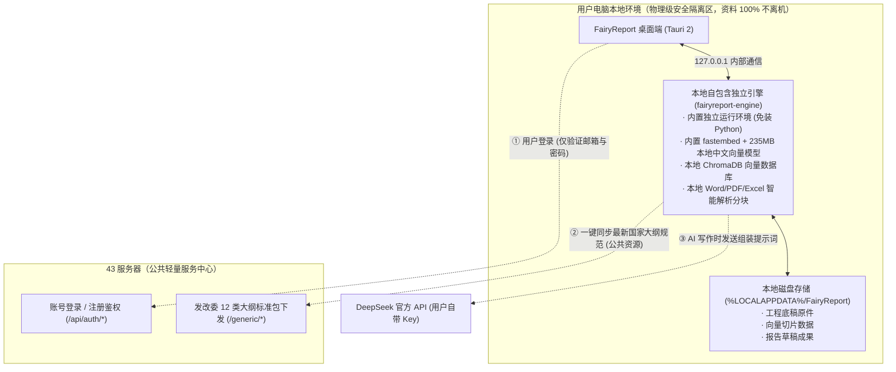
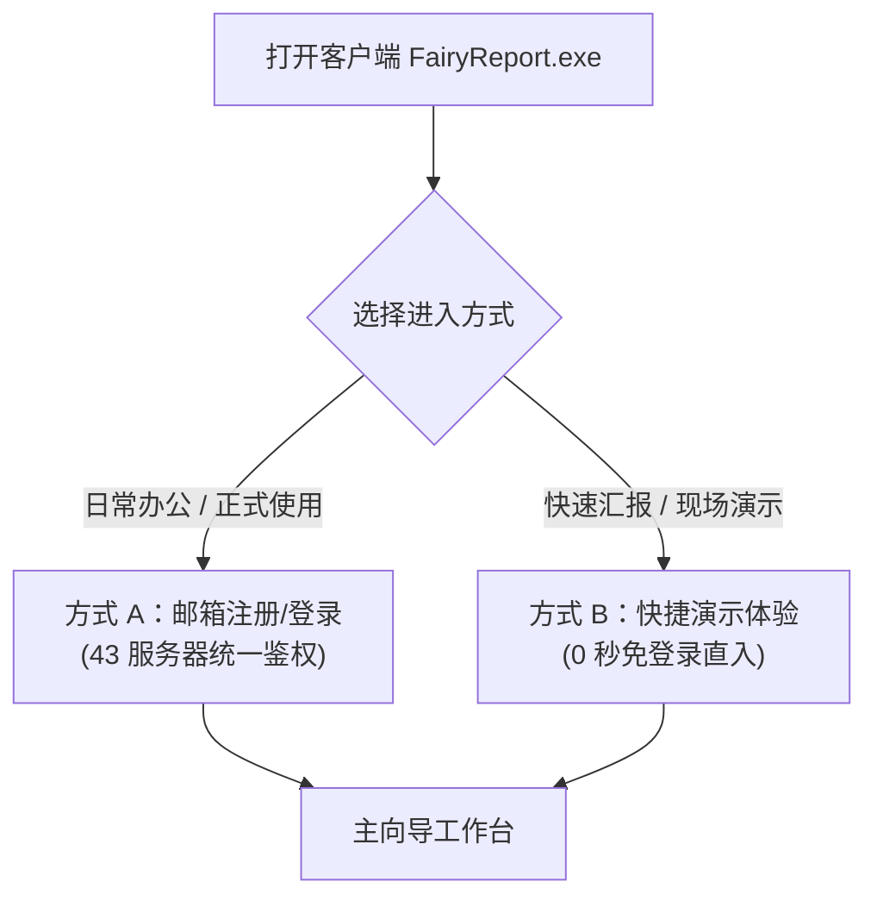
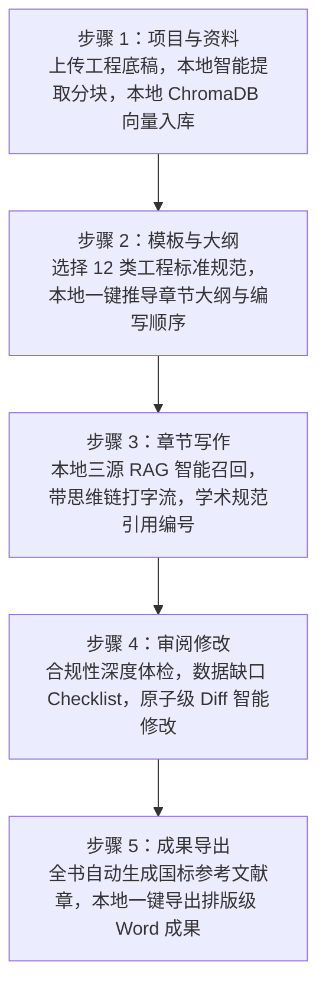

# FairyReport 工程咨询报告智能生成系统 — 用户操作手册

> **版本**：v1.0.0 (Windows x64 / macOS / Linux)  
> **适用对象**：工程咨询师、项目经理、报告审核专家及系统使用人员  
> **核心架构**：**纯本地物理隔离引擎（资料 100% 不出机，零数据上云）** + 43 云端公共中心（账号鉴权与发改委大纲同步）

---

## 目录
- [一、系统简介与运行架构](#一系统简介与运行架构)
- [二、交付版本说明（安全专业版 vs 极轻体验版）](#二交付版本说明安全专业版-vs-极轻体验版)
- [三、快速入门（3 步开箱即用）](#三快速入门3-步开箱即用)
- [四、账号登录与快捷体验](#四账号登录与快捷体验)
- [五、系统配置指南（设置页）](#五系统配置指南设置页)
- [六、核心工作流：五步保姆级全流程操作](#六核心工作流五步保姆级全流程操作)
  - [第 1 步：项目与资料（工程底稿本地解析入库）](#第-1-步项目与资料工程底稿本地解析入库)
  - [第 2 步：模板与大纲（国家标准大纲智能推导）](#第-2-步模板与大纲国家标准大纲智能推导)
  - [第 3 步：章节写作（三源 RAG 智能流式生成）](#第-3-步章节写作三源-rag-智能流式生成)
  - [第 4 步：审阅修改（专家合规质检与靶向修订）](#第-4-步审阅修改专家合规质检与靶向修订)
  - [第 5 步：成果导出（国标规范 Word 一键下载）](#第-5-步成果导出国标规范-word-一键下载)
- [七、多平台支持与常见问题排查（FAQ）](#七多平台支持与常见问题排查faq)

---

## 一、系统简介与运行架构

**FairyReport** 是一款专门面向我国工程咨询行业（涵盖投资项目可行性研究报告、项目建议书、资金申请报告、节能报告等交付物）的 AI 协同生成与数字化审阅工作台。系统严格遵循国家发展改革委相关编制规范，深度融合大语言模型（LLM）与本地检索增强生成（RAG）技术。

### 核心安全保障与特点：
1. **银行级数据物理隔离（资料 100% 不出机）**：
   - 业主的投资估算明细表、规划红线、地质勘察与工艺参数等所有工程底稿，**全部留在用户本地电脑**；
   - 文本提取、切片分块、语义向量计算与 ChromaDB 向量库**100% 在本地离线执行**，任何第三方（包括 43 服务器）绝不接触底稿数据。
2. **免装 Python 开箱即用**：
   - 内置独立计算引擎与 235MB 本地 ONNX 中文向量模型，解压即可运行，低配办公笔记本也能毫秒级向量化。
3. **支持断网底稿入库**：
   - 即使电脑拔掉网线或处于涉密机房，第 1 步的工程底稿解析与向量化入库依然 100% 正常运行！

---

## 二、交付版本说明

针对不同的使用场景，系统提供两个版本：

| 版本名称 | 压缩包体积 | 算力与底稿位置 | 适用场景 | 交付文件名 |
| :--- | :---: | :---: | :--- | :--- |
| **本地安全专业版** *(官方主推·出厂默认)* | **348 MB** | **100% 本地电脑** （内置本地引擎 + 向量模型） | **正式生产使用**：严禁资料外传的甲级设计院、央企咨询院、涉密工程项目。 | `FairyReport-Local-v1.0.0-Windows-x64.zip` |
| **极轻体验版** *(云端演示专用)* | **5.2 MB** | 43 云端服务器 | **外部快速体验**：展会现场扫码、发给潜在客户 5 秒钟极速上手体验。 | `FairyReport-v1.0.0-Windows-x64.zip` |

---

## 三、快速入门（3 步开箱即用）

### 1. 获取软件包
获取压缩包：`FairyReport-Local-v1.0.0-Windows-x64.zip`（约 348 MB）。

### 2. 解压与启动
1. 将压缩包解压至电脑任意磁盘目录（建议路径无特殊字符，例如 `D:\Tools\FairyReport\` 或直接桌面）；
2. 文件夹内包含 `FairyReport.exe` 和 `fairyreport-engine.exe`，**双击运行 `FairyReport.exe` 即可**。

> [!TIP]
> 首次启动时，Windows Defender 可能弹出常规未知发布者保护提示，点击**“更多信息”** -> **“仍要运行”** 即可正常进入。

### 3. 开始使用
启动后客户端将自动在本地唤起独立计算引擎，1~2 秒内自动就绪并进入登录界面。

---

## 四、账号登录与快捷体验

系统提供两种进入方式：

### 方式 A：邮箱账号登录（日常正式使用）
1. 在登录卡片中切换到 **「注册」** 标签；
2. 输入您的常用邮箱，点击 **「发送验证码」**；
3. 打开邮箱查收 6 位数字验证码；
4. 填写验证码并设置密码，点击 **「注册并登录」** 进入系统；
5. 下次使用时，直接在 **「登录」** 标签输入邮箱与密码即可。

### 方式 B：快捷演示体验（快速试用 / 现场演示）
- 点击登录卡片底部的 **「🎯 快捷演示体验（免登录直接进入）」** 绿色按钮；
- 系统将在 0.1 秒内自动建立虚拟演示会话，直接进入报告制作工作台。

---

## 五、系统配置指南（设置页）

进入系统后，点击左侧导航栏底部的 **「系统设置」**。

> [!IMPORTANT]
> **首次使用必须配置项：LLM API Key**  
> 本地引擎与账号服务出厂均已就绪，您仅需配置大模型密钥即可开工！

### 1. 核心计算引擎连接（已出厂预设为本地物理隔离引擎）
- **计算引擎服务地址**：出厂默认**留空**（即走纯本地独立引擎，工程底稿 100% 不离机）；
- 点击右侧 **「测试并连接」**，看到绿色提示 `已切换为本地 Python 引擎并成功就绪！` 说明本地引擎运行正常；
- 若日后需要临时使用云端算力，可填入 `http://101.42.9.223:8000` 并测试连接。

### 2. 认证与知识库服务（已出厂预设）
- **账号与知识库服务地址**：已预设为 `http://101.42.9.223`。
- 负责用户身份校验与发改委大纲规范包下发，保持默认即可。

### 3. LLM 配置（大模型参数配置）
- **API Key**：填入由管理员分发或您自己的 DeepSeek API 密钥（格式如 `sk-xxxxxxxxxxxxxxxxxxxxxxxx`）；
- **Base URL**：保持默认 `https://api.deepseek.com/v1`（若使用特定专线中继可修改）；
- **模型**：默认 `deepseek-v4-flash`（亦可填 `deepseek-chat` 或深度思考模型 `deepseek-reasoner`）；
- 完成后点击 **「保存设置」**。顶部状态灯将显示 **`🟢 本地引擎就绪`**。

---

## 六、核心工作流：五步保姆级全流程操作

---

### 第 1 步：项目与资料（工程底稿本地解析入库）

这是报告生成的基础。将业主提供的所有前期工程资料喂给系统，AI 才能言之有据、绝不胡编乱造。

#### 操作步骤：
1. **新建项目**：
   - 点击 **「新建项目」**，输入项目名称（例如：`XX经开区低空经济产业园可行性研究报告`），确认创建。
2. **选择工程底稿**：
   - 支持格式：**Word (.docx)**、**Excel (.xlsx, .csv)**、**纯文本 (.txt, .md)**、**PDF (.pdf)**（文字版 PDF 原生自动解析分块；纯图片扫描件建议先经 OCR 识别转文本后导入）；
   - 点击 **「选择文件」**（可多选）或直接拖拽文件入框；
   - 亦可点击 **「📁 打开资料目录」** 将底稿直接拷入本地文件夹后点击 **「🔄 扫描本地资料」**。
3. **本地解析入库**：
   - 本地引擎自动执行：**本地文本提取 ➔ 语义切片分块 ➔ 本地 ONNX 向量化 ➔ 本地 ChromaDB 向量建库**；
   - 界面实时显示每个文件的解析状态与生成的知识切片数量（Chunk 数）。
   - **底稿文件与切片 100% 保留在本机本地磁盘，绝不上云！**

---

### 第 2 步：模板与大纲（国家标准大纲智能推导）

根据项目性质选择权威模板，AI 将智能推导最佳的章节结构与编写逻辑顺序。

#### 操作步骤：
1. **选择报告类型**：
   - 在模板下拉列表中选择目标交付物（涵盖国家发改委投资项目可行性研究报告、资金申请报告、节能报告、特许经营方案等 12 种主流工程咨询报告类型）；
   - 系统自动载入该类型的国家标准章节架构与总字数预算建议。
2. **生成大纲**：
   - 点击 **「AI 智能生成大纲」**；
   - 系统结合本地底稿与国家发改委通用大纲，自动推导出最优编写顺序与理由。
3. **人工确认与微调**：
   - 右侧提供 Markdown 大纲编辑器，可直接增加或删减特定子节，修改后点击 **「保存大纲」**。

---

### 第 3 步：章节写作（三源 RAG 智能流式生成）

#### 操作步骤：
1. **选择目标章节**：
   - 左侧章节导航树展示全部章节及状态，点击任意一章。
2. **智能生成正文**：
   - 点击 **「✨ AI 智能撰写此章」**；
   - **本地三源 RAG 检索**：本地引擎在本地向量库中快速召回最相关的项目底稿切片；
   - **思维链透明展现**：展开“AI 构思与推理过程”，实时观察大模型的论证逻辑；
   - **打字机流式输出**：实时打印正文、三线表，并在引用处自动标注规范编号（如 `[1]`、`[2]`）。
3. **批量写作（可选）**：
   - 点击 **「⚡ 批量连续写作全部章节」**，全自动按序生成全书章节。

---

### 第 4 步：审阅修改（专家合规质检与靶向修订）

#### 操作步骤：
1. **发起专家质检**：
   - 点击 **「🔍 启动全书专家级智能审阅」**；
   - 开展多维度合规体检：合规达标度、前后数据自洽性、缺漏项清单（Checklist）与规范性评分。
2. **靶向原子级修订（Diff 对比）**：
   - 针对识别出的缺陷，点击 **「✨ 生成针对性修订方案」**；
   - 弹出红绿高亮的 **Diff 差异对比器**，点击 **「✅ 采纳修订」** 即可一键安全合并。

---

### 第 5 步：成果导出（国标规范 Word 一键下载）

#### 操作步骤：
1. **一键生成成果**：
   - 点击 **「📄 一键导出 Word 报告 (.docx)」**；
   - 本地引擎自动完成排版优化：跨章节引用编号重构、文末自动生成符合 **GB/T 7714 规范** 的《参考文献》目录。
2. **本地保存**：
   - 点击 **「⬇️ 下载 Word 报告到本地」** 保存至电脑；
   - 可直接使用 Microsoft Word 或 WPS 打开该文件进行装订交付。

---

## 七、多平台支持与常见问题排查（FAQ）

### Q1：系统支持 macOS 和 Linux 吗？
- **支持**！仓库已配置跨平台自动化流水线（GitHub Actions）：
  - **macOS**：支持 Apple Silicon 架构的 `.dmg` 拖拽安装包；
  - **Linux**：支持国产操作系统（统信 UOS、银河麒麟、Ubuntu 等）的 `.AppImage` 与 `.deb` 安装包。

### Q2：使用“本地安全专业版”时，我的底稿真的不会被上传吗？
- **绝对不出机**：
  - 本地版内嵌完整的独立的计算引擎和离线向量模型；
  - 所有的底稿解析、切片提取、向量建库均在 `127.0.0.1` 本地回环网络中执行；
  - 只有在向大模型请求撰写正文时，才会发送由本地检索出来的少量相关段落组装的 Prompt，完全保障工程商业机密。

### Q3：如果电脑没有 Python，能运行“本地安全专业版”吗？
- **完全可以**：
  - 专业版为全自包含安装包，内置了所有必要的运行库与模型，**用户电脑无需安装 Python 或任何开发环境**，解压后双击 `FairyReport.exe` 即开即用。

---

*如在使用过程中遇到其他业务疑问，请联系系统管理员获取专属技术支持。*
