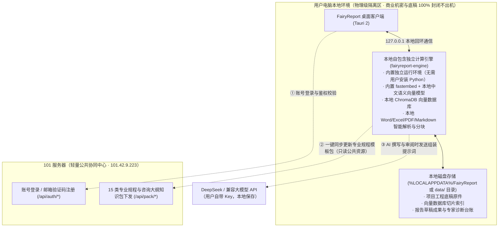
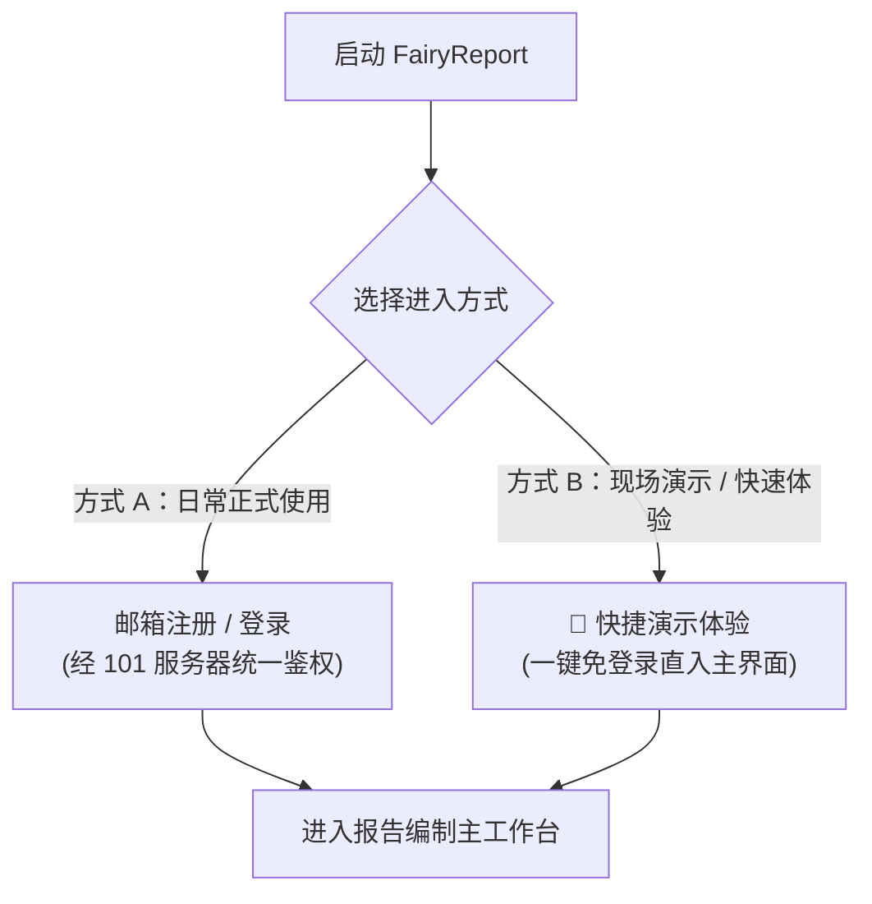

# FairyReport 工程咨询报告智能生成系统 — 用户操作手册

> **版本**：v1.0.0 (Windows x64 / 多平台)  
> **适用对象**：工程咨询师、项目经理、报告审核专家及数字化编制人员  
> **核心架构**：**纯本地物理隔离引擎（资料 100% 不出机，零数据上云）** + 101 云端协同中心（账号鉴权与行业通用规程包同步）

---

## 目录
- [一、系统简介与运行架构](#一系统简介与运行架构)
- [二、交付版本说明（绿色免安装便携版）](#二交付版本说明绿色免安装便携版)
- [三、快速入门与启动](#三快速入门与启动)
- [四、账号登录与快捷体验](#四账号登录与快捷体验)
- [五、系统设置与大模型配置](#五系统设置与大模型配置)
- [六、核心工作流：五步全流程操作](#六核心工作流五步全流程操作)
  - [第 1 步：项目与资料（底稿本地向量化入库与知识包同步）](#第-1-步项目与资料底稿本地向量化入库与知识包同步)
  - [第 2 步：模板与大纲（15 类咨询报告大纲智能推导）](#第-2-步模板与大纲15-类咨询报告大纲智能推导)
  - [第 3 步：章节写作（三源 RAG 智能流式生成与构思推演）](#第-3-步章节写作三源-rag-智能流式生成与构思推演)
  - [第 4 步：审阅修改（专家级规程质检与智能精准重构）](#第-4-步审阅修改专家级规程质检与智能精准重构)
  - [第 5 步：成果导出（行业规范参考文献与出版级 Word 导出）](#第-5-步成果导出行业规范参考文献与出版级-word-导出)
- [七、特色说明：PDF 解析与扫描件处理指引](#七特色说明pdf-解析与扫描件处理指引)
- [八、常见问题排查（FAQ）](#八常见问题排查faq)

---

## 一、系统简介与运行架构

**FairyReport** 是一款专为工程咨询行业（涵盖投资项目可行性研究报告、项目建议书、资金申请报告、节能报告、特许经营方案等 15 类咨询交付物）量身定制的 AI 协同编制与智能审阅工作台。

系统严格遵循行业权威投资项目编制规程，采用**“端云分离、底稿纯本地物理隔离”**的先进架构设计：

### 核心安全保障与特性：
1. **数据绝对不出机（物理级安全隔离）**：
   - 业主的投资估算明细表、勘察勘测报告、规划红线与工程技术方案等底稿文件，**100% 保留在用户本地电脑**；
   - 文本提取、分块切片、语义向量计算与 ChromaDB 向量库**完全在本地离线执行**，任何云端服务均不接触底稿数据。
2. **零环境依赖，开箱即用**：
   - 软件内置全部自包含计算引擎与本地向量模型，**用户电脑无需配置 Python、无需安装任何依赖库**，双击即开即用。
3. **离线高可用**：
   - 即使拔掉网线或处于无外网的内网机房，第 1 步的工程底稿解析、向量化检索建库依然完全正常运行。

---

## 二、交付版本说明（绿色免安装便携版）

为避免 Windows 系统目录权限限制与未签名安装向导的拦截阻碍，系统统一采用**免安装绿色便携版**进行交付分发：

| 交付形态 | 文件名 | 体积 | 特点与适用场景 |
| :--- | :--- | :---: | :--- |
| **绿色免安装便携版** | `FairyReport-Local-v1.0.0-Windows-x64.zip` | 约 370 MB | **解压即用**：无需安装向导、无需管理员权限、不写系统注册表。自带 `.portable` 便携标记，项目底稿与向量数据全部保存在同级 `data/` 目录中，支持 U 盘携带或拷贝至任意电脑即开即用。 |

---

## 三、快速入门与启动

1. 打开压缩包 `FairyReport-Local-v1.0.0-Windows-x64.zip`；
2. 将其解压至电脑任意磁盘目录（例如 `D:\Tools\FairyReport\` 或直接解压到桌面）；
3. 打开解压后的文件夹，**双击运行 `FairyReport.exe`** 即可启动。

> [!TIP]
> **关于安全提示**：首次启动时，Windows Defender 可能会弹出常规“未识别应用”保护提示，点击**“更多信息”** ➔ **“仍要运行”** 即可正常进入。启动后系统将在后台自动唤醒本地独立计算引擎（无黑色命令行窗口）。

---

## 四、账号登录与快捷体验

启动软件后，系统提供两种灵活的登录方式：

### 方式 A：邮箱账号登录（日常正式使用）
1. 在登录界面切换至 **「注册」** 标签；
2. 输入您的常用工作邮箱，点击 **「发送验证码」**；
3. 查收由 101 服务器发送的邮件验证码；
4. 填写验证码并设置您的密码，点击 **「注册并登录」** 进入系统；
5. 下次使用时，直接在 **「登录」** 标签输入邮箱与密码即可登录。

### 方式 B：快捷演示体验（快速上手 / 方案汇报）
- 直接点击登录卡片底部的 **「🎯 快捷演示体验（免登录直接进入）」** 按钮；
- 系统将在 0.1 秒内自动建立本地演示会话，直接进入主界面体验全部功能。

---

## 五、系统设置与大模型配置

首次进入系统后，请点击左下角（或右上角）的 **「系统设置」** 完成一次性初始化配置。

> [!IMPORTANT]
> **首次使用唯一必配项：LLM API Key**  
> 核心计算引擎与认证服务出厂均已就绪，您只需填入大模型密钥即可开工写作！

### 1. 核心计算引擎连接
- **计算引擎服务地址**：出厂默认**留空**（即走纯本地独立物理隔离引擎，底稿 100% 封闭在本地运行）；
- 点击右侧 **「默认(本地)」** 或 **「测试并连接」**，提示绿色 `已启动本地独立计算引擎并成功就绪` 即表示本地引擎工作正常。

### 2. 认证与知识库服务
- **账号与知识库服务地址**：出厂已默认预设为 **`http://101.42.9.223`**；
- 负责用户身份鉴权与 15 类咨询大纲模板包下发，保持默认即可。

### 3. LLM 配置（大语言模型参数）
- **API Key**：填入您的 DeepSeek API 密钥（格式如 `sk-xxxxxxxxxxxxxxxxxxxxxxxx`）；
- **Base URL**：默认 `https://api.deepseek.com/v1`（兼容任意 OpenAI 格式的中继或私有化大模型地址）；
- **模型**：默认 `deepseek-v4-flash`（可根据需要填入 `deepseek-chat` 或推理模型 `deepseek-reasoner`）；
- 配置完成后点击 **「保存设置」**。密钥仅保存在本地设备，绝不上云。

---

## 六、核心工作流：五步全流程操作

---

### 第 1 步：项目与资料（底稿本地向量化入库与知识包同步）

#### 1. 项目管理
- 点击 **「+ 新建项目」**，输入项目名称（例如：`利辛县现代农业产业示范园可行性研究报告`），点击“创建”；
- 下拉框可自由切换不同历史项目，支持随时删除旧项目。

#### 2. 通用知识包同步
- 在“通用知识包状态”卡片中，点击 **「从云端同步知识包」**（或“检查云端更新”）；
- 系统将从 101 服务器自动拉取 15 类专业工程规程与行业模板库，并在本地解压就绪。

#### 3. 底稿资料向量化入库
- **支持格式**：`.docx`（Word）、`.xlsx` / `.csv`（Excel 表格）、`.txt` / `.md`（纯文本）、`.pdf`（文字版 PDF）；
- **导入方式**：点击 **「选择文件」** 多选选取，或直接将底稿拖拽到虚线上传框内；亦可点击 **「📁 打开资料目录」** 将文件直接拷入后点击 **「🔄 扫描本地资料」**；
- **智能分块与向量化**：本地引擎自动完成文本抽取、语义分块、向量计算并存入本地 ChromaDB 数据库，列表实时显示文件大小与分块数（Chunk 数）。

---

### 第 2 步：模板与大纲（15 类咨询报告大纲智能推导）

1. **选择交付物类型**：
   - 系统内置投资项目可行性研究报告、项目建议书、资金申请报告、节能报告、特许经营方案等 **15 类主流咨询交付物标准模板**；
2. **智能生成大纲与编写顺序**：
   - 点击 **「AI 智能生成大纲」**，大模型自动结合底稿关键指标与行业标准模板，推导出最契合的大纲架构，并给出最优的编写顺序（如先写工程方案、投资估算等主体章节，最后提炼第一章概述与结论，确保逻辑自洽）；
3. **人工调整与即时保存**：
   - 右侧双栏支持 Markdown 大纲源码与章节树实时联动预览，可自由添加或删减子节。

---

### 第 3 步：章节写作（三源 RAG 智能流式生成与构思推演）

1. **单章与全书推荐顺序流式写作**：
   - 点击左侧目录树中的具体章节，点击 **「✍️ 单章流式写作」**；或点击上方 **「🚀 一键开始全书写作」**（按照推荐的最佳依赖顺序全自动连续推进）；
2. **专业推演思考栏（💡 图标）**：
   - 撰写过程中，上方提供 **`💡 深度技术推演与工程构思过程 (纯中文)`** 思考折叠卡片；
   - 实时展示大模型结合工程底稿、行业规程与政务联网信息的三源 RAG 检索推演，论证细节一目了然；
3. **所见即所得打字机与就地编辑**：
   - 正文画布以出版级规范排版（10.5pt、三线表、工程级缩进）实时流式呈现；
   - **支持直接在正文文字上点击光标进行输入、修改与润色**，修改内容 300ms 自动落盘保存；
   - 正文中自动打标引用出处标签（如 `【源:批复文件.docx】`、`【标:规范】`、`【网:权威出处】`），点击右侧抽屉可一键溯源定位。

---

### 第 4 步：审阅修改（专家级规程质检与智能精准重构）

1. **发起专家级深度体检（🔬 图标）**：
   - 点击 **「🔍 审阅本章」** 或 **「🚀 一键全书审阅」**；
   - 推演栏展示 **`🔬 专家深度质检与规程校核过程 (纯中文)`**，系统对照行业投资项目编制规范与行业规程对论述深度、技术参数与前后数值自洽性进行全维度排查；
   - 右侧抽屉自动生成：
     - **⚠️ 审阅问题台账**（严重/重大/一般，附带原文片段与修改建议）；
     - **🔢 数值校核台账**（正文提及值 vs 底稿参考值一致性比对）；
     - **🧩 缺项排查台账**（识别本行业必须具备的论证要点是否遗漏）；
2. **AI 外科手术式智能修订（⚡ 图标）**：
   - 在问题卡片上点击 **「⚡ 局部修复」**，或在正文上方点击 **「⚡ AI 智能修订」**；
   - 推演栏展示 **`⚡ AI 专家智能修订推演过程 (纯中文)`**，统筹诊断建议在画布中就地重构文本；
   - 若对修改效果不满意，可随时点击 **「↩️ 撤销修改」** 恢复原版。

---

### 第 5 步：成果导出（行业规范参考文献与出版级 Word 导出）

1. **参考文献智能归并**：
   - 导出页自动归并全书所有正文引用的底稿、标准与网页出处；
   - 自动按照文献著录规范 **GB/T 7714** 格式生成全书规范参考文献目录；
2. **一键生成 Word 文档**：
   - 点击 **「📄 一键导出出版级 Word 报告」**；
   - 本地引擎自动完成多级标题排版、表格三线表绘制与悬挂缩进；
   - 导出成功后点击 **「📁 打开文件所在目录」**，即可直接用于装订交付。

---

## 七、特色说明：PDF 解析与扫描件处理指引

在实际工程中，业主提供的 PDF 底稿通常分为两种不同类型，系统处理机制如下：

### 1. 文字版 PDF（原生支持 · 秒级入库）
- **特征**：由 Word、WPS、AutoCAD、浏览器“另存为”生成的电子矢量 PDF，在阅读器中鼠标可以自由滑动框选文字；
- **系统表现**：拖入即可直接秒级解析提取文字、分块切片并入库。

### 2. 纯图片扫描件 PDF（需先经 OCR 识别转文字）
- **特征**：由纸质纸张、红头批复、实物盖章件经扫描仪扫描或拍照生成的 PDF。此类文件**内部仅包含位图照片，文字层字符数为 0**；
- **系统表现**：
  - 本地引擎检测到字符数为 0 时，不会强行入库空内容；
  - 界面会立即弹出常驻且醒目的 **「⚠️ 发现文件未能成功解析入库」专属排查卡片**，明确提示为扫描件并提供处理指引；
- **推荐极速解决方案**：
  1. **电脑微信**：将该扫描件 PDF 发送到电脑微信任意对话中打开，点击右上角「提取文字」或「转为 Word」；
  2. **WPS / 福昕阅读器**：使用内置的「OCR 文字识别」功能导出为 `.docx`、`.txt` 或 `.md`；
  3. 将识别后的文件重新拖入客户端，即可正常分块建库并参与写作！

---

## 八、常见问题排查（FAQ）

### Q1：使用过程中我的工程底稿和数据会泄露吗？
- **绝无泄露可能**：
  - 本地独立计算引擎（Chroma 向量库与 ONNX 语义计算）全部运行在您本地电脑的 `127.0.0.1` 离线回环网络中；
  - 101 服务器仅提供轻量公共服务（账号验证码和标准规程模板更新），从不接收、不存储用户的任何底稿数据；
  - 调用大模型写作时，仅组装当前章节所需的 Prompt，保障商业机密安全。

### Q2：软件启动时提示本地引擎连接失败怎么办？
- 请检查是否有多开软件实例；
- 打开系统设置，确认“计算引擎服务地址”保持**默认留空**，然后点击右侧「默认(本地)」，再点击「测试并连接」；
- 如需查看底层运行日志，可按 `Win + R` 输入 `%LOCALAPPDATA%\FairyReport\fairyreport.log` 查看详细日志信息。

### Q3：换电脑使用时如何迁移数据？
- **便携版数据迁移极简**：由于系统完全采用绿色便携模式，所有工程底稿和本地向量数据库均存放在解压目录下的 `data/` 文件夹中。只需将包含 `FairyReport.exe` 和 `data/` 文件夹的整个目录拷贝到新电脑或 U 盘，即可完整无损迁移全部历史项目。

---

*如在使用过程中遇到任何问题，欢迎随时联系系统管理员获取技术支持与规程包更新。*
