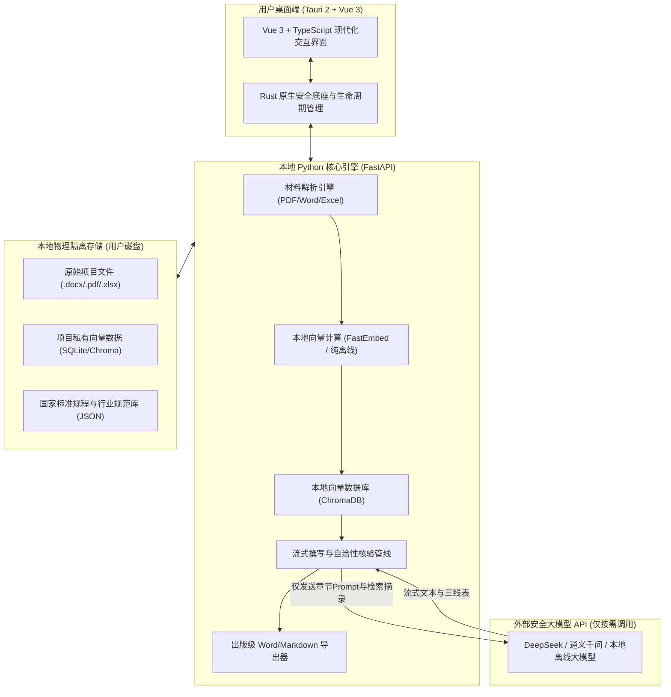

# 系统架构与三源物理隔离 🛡️

FairyReport 专为对**数据安全性**、**规范合规性**和**输出严谨度**有严苛要求的投资项目与工程咨询场景设计。整个系统建立在现代桌面混合架构与三源 RAG 智识矩阵之上。

---

## 🏛️ 系统总体架构

FairyReport 采用轻量高效的 **Tauri 2 + 原生 Web 前端 + 独立高性能 Python 引擎** 架构：

---

## 🔒 纯本地物理隔离 · 数据安全保证

对于重大工程咨询、产业规划和企业投资决策，底稿数据往往涉及敏感商业机密。FairyReport 从底层架构上彻底拒绝“全云端黑盒”：

1. **原始文件零外泄**：
   - 导入的项目立项书、财务测算表、技术规范等文件全部存放在本机用户应用数据目录中（Windows 为 `%LOCALAPPDATA%\FairyReport\`）。
   - 系统绝不会将整份文档或原始压缩包上传至任何云端服务器。
2. **纯本地离线向量化**：
   - 文档的切片、分块（Chunking）与向量嵌入计算（Embedding）完全使用本地轻量化模型在用户本机 CPU/GPU 完成，不需要联网上传向量数据。
3. **极小化上下文交互原则**：
   - 当调用大模型进行流式撰写时，系统仅将与当前章节直接相关的**百余字参考文本碎片**与**国家规程写作要求**作为 Prompt 上下文发送给大模型，原始文档整体结构与全貌始终物理留存于本地。
4. **支持全离线脱机运行**：
   - 在高保密等级环境下，FairyReport 支持直接对接局域网或本机部署的开源模型（如 Ollama + DeepSeek-R1 / Qwen2.5），实现 100% 断网离线闭环运行。

---

## 🧠 三源 RAG 智识矩阵

普通 RAG 仅从单一上传文档中做向量检索，容易陷入“无材料则言之无物，有材料则机械抄袭”的困局。FairyReport 独创**三源 RAG 智识矩阵**：

| 智识来源 | 物理存储方式 | 核心作用与能力 |
| :--- | :--- | :--- |
| **源 A · 项目私有材料** | 本地私有 Chroma 向量库 | 精准提取项目独有数据：建设地点、规模产能、工艺路线、投资估算指标。 |
| **源 B · 行业规程与规范库** | 内置只读 JSON 规程库 | 锚定国家发改委标准体例、各专业技术规范、必备章节要素与审查指标。 |
| **源 C · 外部权威联网检索** | 按需实时轻量搜索引擎 | 动态补充最新宏观政策背景、行业碳排放基准、同类项目国际对标数据。 |

三路智识通过专有混合检索算法动态配比，既能确保工程报告的真实性与合规性，又赋予了针对前沿新型课题（如新质生产力、算力中心、低空经济）的敏锐洞察与实时建言能力。
