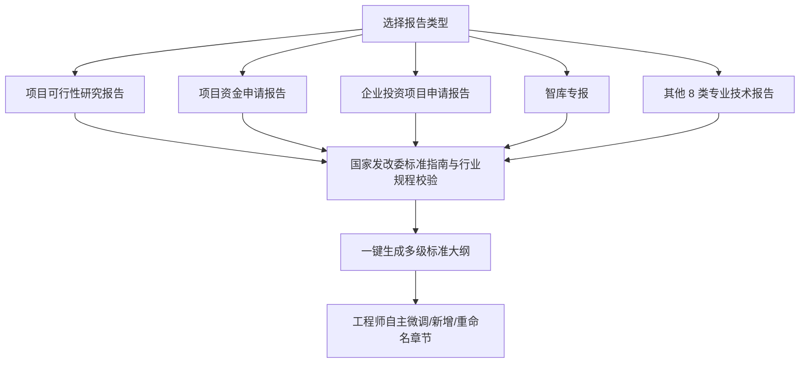

# 五步全流程端到端工作台深度解析 ⚙️

FairyReport 将传统工程咨询与投资项目编制中繁杂低效的“资料阅读 ➔ 目录拟定 ➔ 执笔撰写 ➔ 专家校审 ➔ 格式排版”全流程，重构为五个标准化、端到端的流水线步骤。

---

## 阶段一 · 材料解析与向量智识库建立 📂

在项目启动阶段，系统支持将用户上传的多源文档进行统一物理治理：

1. **多格式原生解析**：
   - 深入支持 Word (`.docx`)、Excel 财务测算表 (`.xlsx`)、电子版可搜索 PDF、Markdown 和纯文本。
   - 提取表格中的行列关系与关键财务指标，保留语义层级。
2. **智能分块与向量化**：
   - 采用自适应语义滑动窗口对文本进行切片，内置重叠约束算法，防止死循环与文本截断。
   - 向量计算在本地离线高效完成，写入用户本地 ChromaDB 数据库。
3. **智库专报“资料留空”特性**：
   - 对于宏观政策、产业观察等智库专报，用户无需强行准备项目材料，系统依托内置通用规程库和轻量实时联网检索即可独立闭环。

---

## 阶段二 · 12 类报告规程大纲规划 📋

目录是报告的灵魂与骨架。FairyReport 内置针对 12 类不同审批要求的报告规范体系：

- **规程自适应**：自动根据报告类型注入国家最新编制体例要求。
- **自由交互**：支持拖拽重排序、增删子章节、修改写作侧重点。

---

## 阶段三 · 三源融合流式智能撰写 ✍️

撰写过程采用实时流式传输（SSE），文字如行云流水般跃然屏上：

1. **三源 RAG 智识注入**：
   - 撰写每一章节前，系统在后台对该章节的核心议题进行三路召回（私有文档 + 规程要求 + 联网补充），并在 Prompt 中精准注水。
2. **原生工程规范三线表**：
   - 系统受控要求模型直接输出符合工程技术规范的结构化表格，杜绝杂乱纯文本排版。
3. **精准角标引证**：
   - 在正文重要论点和数据后，自动附带来源角标（如 `[规程-发改投资]`, `[项目材料-财务表]`），实现论据可追溯。

---

## 阶段四 · 多维专家在线审阅抽屉 🧐

完成初稿后，系统提供模拟资深专家的在线审查机制：

- **多维把关指标**：
  - **政策合规性**：是否遵循产业指导目录、碳减排与发改投资政策。
  - **数据自洽性**：工程规模、投资额度、占地面积是否前后一致。
  - **论述完整性**：核心必选章节是否留空或论证不足。
- **一键采纳润色**：
  - 专家意见以抽屉卡片形式呈现，点击「采纳建议」即可驱动模型针对性改写和强化，无需人工手动查找定位。

---

## 阶段五 · 跨章节自洽核验与出版级 Word 导出 🖨️

在最终交付前，FairyReport 提供最后的质量门禁与出版级排版输出：

1. **跨章节矛盾深度核验**：
   - 提取全书关键量化参数（总投资额、建设周期、能耗 PUE、主要产能等），进行双轨交叉比对，给出自洽性得分。
2. **出版级 Word 自动化排版**：
   - 采用标准公文排版引擎，自动应用：
     - 标准封面（含项目全称、编制单位、编制日期）；
     - 自动更新的文档目录；
     - 正文小四仿宋，1.5 倍行间距；
     - 工程标准三线表（顶线、底线 1.5 磅粗线，栏目线 0.75 磅细线，单元格内容居中）；
     - 图表编号与说明；
3. **成果交付物**：
   - 导出的 `.docx` 文档格式纯正，可直接作为合规初稿向上级部门、业主单位或评审专家呈报。
