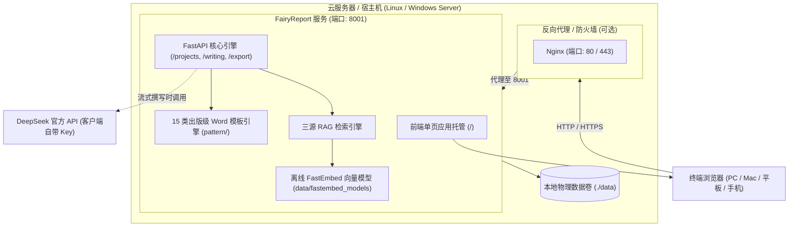

# FairyReport 智能报告编制应用 · 云端部署运维与操作手册 (v1.6.2)

> **适用交付物**：`FairyReport-Cloud-Deploy-v1.6.2.zip`  
> **适用对象**：系统管理员、云运维工程师、企业 IT 部门、技术支持人员  
> **适用环境**：Linux (Ubuntu / Debian / CentOS / Rocky / Alpine)、Windows Server、macOS  

---

## 目录

- [一、 系统架构与部署包概览](#一-系统架构与部署包概览)
- [二、 服务器环境与前置准备](#二-服务器环境与前置准备)
- [三、 部署方案 A：Docker 容器化一键部署（推荐）](#三-部署方案-a-docker-容器化一键部署推荐)
- [四、 部署方案 B：裸机 Python 部署（无 Docker 环境）](#四-部署方案-b-裸机-python-部署无-docker-环境)
- [五、 生产级反向代理与安全加固（Nginx + HTTPS）](#五-生产级反向代理与安全加固nginx--https)
- [六、 终端多用户与浏览器访问操作指引](#六-终端多用户与浏览器访问操作指引)
- [七、 数据持久化、备份与版本迁移](#七-数据持久化备份与版本迁移)
- [八、 常见故障排查与运维诊断 (FAQ)](#八-常见故障排查与运维诊断-faq)

---

## 一、 系统架构与部署包概览

FairyReport 云端部署包采用 **前后端单端口一体化架构**，将 Vue 3 生产静态前端与 FastAPI 智能计算引擎融合在同一个服务进程中，终端用户通过现代浏览器即可使用全套 AI 编制功能。



### 部署包内部核心文件结构

```text
FairyReport-Cloud-Deploy-v1.6.2/
├── Dockerfile                         # 生产级 Python 3.11 容器构建脚本
├── docker-compose.yml                 # 一键编排配置文件（端口、环境变量与数据卷）
├── .dockerignore                      # 容器构建安全过滤规则
├── start_cloud.sh                     # Linux / macOS 裸机快速启动脚本
├── start_cloud.bat                    # Windows Server 裸机快速启动脚本
├── 云端部署操作手册.md                # 本运维操作手册
├── requirements.txt                   # Python 核心依赖库清单
├── engine/                            # 后端计算、RAG 向量检索与报告生成核心源码
├── generic_knowledge/                 # 15 类报告国家标准规程与编制规则库
├── pattern/                           # 15 类出版级 Word 模板包（.docx）
├── desktop/
│   ├── dist/                          # 编译就绪的前端静态网页资产（解压即用，无需 Node）
│   └── src/                           # 前端 Vue 3 源码（供企业做界面二次定制）
└── data/
    └── fastembed_models/              # 预置离线中文嵌入模型（BAAI/bge-small-zh-v1.5，约240MB）
```

---

## 二、 服务器环境与前置准备

### 1. 硬件配置推荐

| 规模 / 场景 | CPU | 内存 (RAM) | 磁盘可用空间 | 说明 |
| :--- | :--- | :--- | :--- | :--- |
| **测试 / 小微团队 (1~5 人)** | 2 核 | 4 GB | 20 GB 以上 | 基础运行、小文件解析向量化 |
| **标准生产 (5~20 人并发)** | 4 核 | 8 GB | 50 GB 以上 | 流畅处理大文档、批量向量检索 |
| **企业级高并发 (20 人以上)** | 8 核 | 16 GB | 100 GB 以上 SSD | 极速并发向量计算、高频流式输出 |

### 2. 操作系统与软件依赖
- **操作系统**：Ubuntu 20.04/22.04 LTS、Debian 11/12、CentOS 7.9/8/9、Rocky Linux、Windows Server 2016+。
- **方案 A（Docker）**：Docker 20.10+ 与 Docker Compose 2.0+。
- **方案 B（裸机）**：Python 3.10+、pip、git（可选）。

### 3. 网络与防火墙（云安全组规则）
请在云服务商控制台（阿里云/腾讯云/华为云/AWS 等）的安全组添加入方向放行规则：

| 协议 | 端口 | 来源 | 用途 |
| :--- | :--- | :--- | :--- |
| **TCP** | `8001` | `0.0.0.0/0`（或内网网段） | FairyReport 默认服务端口（若不用 Nginx 代理） |
| **TCP** | `80` | `0.0.0.0/0` | HTTP 网页标准端口（使用 Nginx 反代时） |
| **TCP** | `443` | `0.0.0.0/0` | HTTPS 加密安全端口（使用 Nginx + SSL 时） |

---

## 三、 部署方案 A：Docker 容器化一键部署（推荐）

Docker 部署具备**环境隔离彻底、跨平台一致、数据与镜像分离、秒级拉起**等优势。

### 步骤 1：上传并解压部署包
将 `FairyReport-Cloud-Deploy-v1.6.2.zip` 上传至服务器目录（如 `/opt`）：
```bash
# 安装 unzip（若未安装）
# Debian/Ubuntu: apt-get install -y unzip
# CentOS/Rocky: yum install -y unzip

cd /opt
unzip FairyReport-Cloud-Deploy-v1.6.2.zip -d /opt/fairyreport
cd /opt/fairyreport
```

### 步骤 2：检查或定制 `docker-compose.yml`
默认配置已满足绝大多数生产环境要求：
```yaml
version: "3.8"

services:
  fairyreport:
    build:
      context: .
      dockerfile: Dockerfile
    container_name: fairyreport-cloud
    restart: unless-stopped
    ports:
      - "8001:8001"                    # 左侧为宿主机映射端口，可改为 "80:8001"
    environment:
      - HOST=0.0.0.0
      - PORT=8001
      - ENGINE_DATA_DIR=/app/data
    volumes:
      - fairyreport_data:/app/data     # 生产数据卷持久化存储

volumes:
  fairyreport_data:
    driver: local
```

> **提示**：如果您希望直接使用 80 端口，可将 `ports` 改为 `- "80:8001"`。

### 步骤 3：构建并启动容器
```bash
docker compose up -d --build
```
> **首次构建**：镜像会基于 `python:3.11-slim` 安装 `requirements.txt`。由于安装包已内嵌离线模型 `fastembed_models`，构建完成后启动无需联网下载任何模型权重。

### 步骤 4：检查容器运行状态与健康检查
```bash
# 查看容器状态（显示 healthy 表示健康就绪）
docker compose ps

# 查看实时运行日志
docker compose logs -f

# 本机健康探测
curl http://127.0.0.1:8001/health
# 期望返回: {"status":"ok","host":"0.0.0.0"}
```

### 步骤 5：常用容器管理命令
```bash
# 停止服务
docker compose stop

# 启动服务
docker compose start

# 重启服务
docker compose restart

# 完全销毁容器（注意：持久化数据卷不会丢失）
docker compose down
```

---

## 四、 部署方案 B：裸机 Python 部署（无 Docker 环境）

若目标服务器无 Docker 环境，可使用裸机 Python 3.10+ 直接运行。

### 步骤 1：解压并就绪源码
```bash
cd /opt
unzip FairyReport-Cloud-Deploy-v1.6.2.zip -d /opt/fairyreport
cd /opt/fairyreport
```

### 步骤 2：配置 Python 虚拟环境与依赖
推荐使用 Python 虚拟环境，避免污染系统全局环境：
```bash
# 创建虚拟环境
python3 -m venv venv

# 激活虚拟环境
source venv/bin/activate    # Linux / macOS
# Windows 执行: venv\Scripts\activate

# 升级 pip 并安装核心依赖
pip install --upgrade pip
pip install -r requirements.txt
```

### 步骤 3：启动服务

#### 选项 1：使用内置一键启动脚本
- **Linux / macOS**：
  ```bash
  chmod +x start_cloud.sh
  ./start_cloud.sh
  ```
- **Windows Server**：
  双击运行 `start_cloud.bat`，或在命令提示符窗口执行：
  ```cmd
  start_cloud.bat
  ```

#### 选项 2：通过命令行自定义参数启动
```bash
# 激活环境后执行
python -m engine.app.main --host 0.0.0.0 --port 8001
```

### 步骤 4：Linux 系统服务常驻（Systemd 配置，可选推荐）
为了让服务开机自启并在异常退出时自动拉起，可配置 Systemd 守护进程：

1. 创建服务文件：
   ```bash
   sudo nano /etc/systemd/system/fairyreport.service
   ```
2. 写入以下内容：
   ```ini
   [Unit]
   Description=FairyReport Cloud Engine Service
   After=network.target

   [Service]
   Type=simple
   User=root
   WorkingDirectory=/opt/fairyreport
   ExecStart=/opt/fairyreport/venv/bin/python -m engine.app.main --host 0.0.0.0 --port 8001
   Restart=always
   RestartSec=5
   Environment=ENGINE_DATA_DIR=/opt/fairyreport/data
   Environment=PYTHONUNBUFFERED=1

   [Install]
   WantedBy=multi-user.target
   ```
3. 启用并启动服务：
   ```bash
   sudo systemctl daemon-reload
   sudo systemctl enable fairyreport
   sudo systemctl start fairyreport

   # 查看运行状态
   sudo systemctl status fairyreport
   ```

---

## 五、 生产级反向代理与安全加固（Nginx + HTTPS）

在企业公网部署中，强烈建议前端挂载 Nginx 并配置 SSL 证书，以便支持标准 HTTPS（443 端口）并优化大文件上传和流式传输响应。

### 1. 完整 Nginx 虚拟主机配置示例
在 `/etc/nginx/conf.d/fairyreport.conf` 中创建配置：

```nginx
server {
    listen 80;
    server_name report.yourcompany.com;
    # 强制跳转 HTTPS
    return 301 https://$host$request_uri;
}

server {
    listen 443 ssl http2;
    server_name report.yourcompany.com;

    # SSL 证书配置（替换为您的实际路径）
    ssl_certificate /etc/nginx/ssl/fairyreport.crt;
    ssl_certificate_key /etc/nginx/ssl/fairyreport.key;
    ssl_protocols TLSv1.2 TLSv1.3;
    ssl_ciphers HIGH:!aNULL:!MD5;

    # 关键参数 1：允许上传大文件（资料支持最大 100MB）
    client_max_body_size 100M;

    # 关键参数 2：关闭代理缓冲，保障流式撰写打字机实时推流
    proxy_buffering off;
    proxy_cache off;
    proxy_read_timeout 300s;
    proxy_send_timeout 300s;

    location / {
        proxy_pass http://127.0.0.1:8001;
        proxy_set_header Host $host;
        proxy_set_header X-Real-IP $remote_addr;
        proxy_set_header X-Forwarded-For $proxy_add_x_forwarded_for;
        proxy_set_header X-Forwarded-Proto $scheme;

        # WebSocket 支持（若后续扩展长连接）
        proxy_http_version 1.1;
        proxy_set_header Upgrade $http_upgrade;
        proxy_set_header Connection "upgrade";
    }
}
```

测试并重载 Nginx：
```bash
sudo nginx -t
sudo systemctl reload nginx
```

---

## 六、 终端多用户与浏览器访问操作指引

云端部署完成后，团队成员可以在任何设备（PC、MacBook、iPad、手机）上通过浏览器访问：

### 1. 打开工作台
在浏览器中输入 `http://<服务器IP>:8001`（或绑定的域名 `https://report.yourcompany.com`）。

### 2. 免登录体验或团队认证
- **免登录直达**：在登录界面下方点击 **「🎯 快捷演示体验（免登录直接进入）」**，即可直接跳过认证进入主界面。
- **账号体系**：若配置了企业集中认证中心，支持输入企业邮箱与验证码登录。

### 3. 配置个人 DeepSeek API Key（客户端安全隔离）
1. 点击右上角 **「⚙️ 设置」** 图标；
2. **基础地址 (Base URL)**：保持官方标准 `https://api.deepseek.com`；
3. **API Key**：用户填入自己在 DeepSeek 开放平台申请的私有 Key；
4. **模型选择**：选择 `deepseek-chat`（通用写作）或 `deepseek-reasoner`（逻辑严密推理），也可点击「🔄 获取最新模型」动态拉取；
5. **保存配置**：点击保存。
> **安全机制**：用户的 API Key **仅加密存储在用户自己的浏览器本地（LocalStorage）**，绝对不会写入服务器的数据库或文件系统。团队多人共用同一套云端实例，各自的 Key 完全物理隔离，保证费用和凭据绝对安全。

### 4. 资料导入与全文解析
- 在 **步骤 1（项目与资料）** 中：
  - 点击「新建项目」输入项目名称；
  - 点击「选择文件」按钮从本地电脑选取资料，或**直接将文件拖拽至虚线框中**；
  - 支持 `.docx`、`.xlsx`、`.csv`、`.md`、`.txt`、`.pdf`；
  - 文件通过浏览器无损读取并上传至云端引擎，后端自动进行清洗、文本切片并利用离线 BGE 向量模型完成本地索引入库。

### 5. 撰写与成果导出
- 按照 **步骤 2（大纲生成）** -> **步骤 3（分章节流式撰写）** -> **步骤 4（一致性审查与修改）** 流转；
- 在 **步骤 5（成果导出）** 中：
  - 点击「🚀 一键导出 Word 报告 (.docx)」；
  - 导出成功后，页面显示文件体积，点击 **「📥 下载文件」** 按钮，浏览器即可直接将排版完美的 Word 成果保存到本地电脑。

---

## 七、 数据持久化、备份与版本迁移

### 1. 数据存储结构
无论 Docker 还是裸机部署，所有运行时生成的业务数据均存放在 `data/` 目录中：
```text
data/
├── engine.db                     # SQLite 数据库（记录项目信息、资料元数据、章节与审阅记录）
└── projects/                     # 项目资产总目录
    ├── <项目名 A>/
    │   ├── files/                # 原始上传文件
    │   └── vector/               # 该项目的 ChromaDB 本地向量数据库与索引索引
    └── <项目名 B>/
```

### 2. 数据备份策略
#### Docker 容器环境备份：
```bash
# 将 Docker Volume 备份为压缩归档
docker run --rm \
  -v fairyreport_data:/data \
  -v $(pwd):/backup \
  alpine tar czf /backup/fairyreport_data_backup_$(date +%Y%m%d).tar.gz -C /data .
```
执行后会在当前目录生成形如 `fairyreport_data_backup_20260929.tar.gz` 的完整备份文件。

#### 裸机环境备份：
只需定期备份 `/opt/fairyreport/data/` 目录即可：
```bash
tar -czvf fairyreport_data_$(date +%Y%m%d).tar.gz /opt/fairyreport/data/
```

### 3. 数据还原流程
在新的服务器部署好 FairyReport 后，将备份包解压回对应的数据目录：
```bash
# Docker 环境还原
docker run --rm \
  -v fairyreport_data:/data \
  -v $(pwd):/backup \
  alpine tar xzf /backup/fairyreport_data_backup_XXXX.tar.gz -C /data
```

### 4. 版本升级方法
当获取到新版部署包时：
1. `docker compose down` 停止旧容器；
2. 保持数据卷不变，解压新版部署包覆盖程序文件；
3. 执行 `docker compose up -d --build` 重新构建并启动，新系统将无缝继承旧版所有项目数据与向量库。

---

## 八、 常见故障排查与运维诊断 (FAQ)

### Q1: 浏览器打开网页提示“无法访问此网站”或连接超时？
- **排查步骤**：
  1. 检查服务器防火墙与云服务商**安全组**，确认 TCP `8001`（或 `80`）入方向端口已放行；
  2. 在服务器本机执行 `curl http://127.0.0.1:8001/health`，若能返回 `{"status":"ok"}` 则服务正常，问题多在网络策略；
  3. 执行 `netstat -tlpn | grep 8001` 或 `docker compose ps` 查看端口监听是否正常。

### Q2: 上传超过 20MB 的大型 PDF 或材料时报错 413？
- **原因**：若使用了 Nginx 作为反向代理，Nginx 默认限制客户端上传大小为 1MB。
- **解决**：在 Nginx 对应 `server` 或 `location` 块中加入：
  ```nginx
  client_max_body_size 100M;
  ```
  执行 `nginx -s reload` 生效。

### Q3: 章节撰写时，前端打字机效果偶发卡顿或大段文字一次性喷出？
- **原因**：反向代理开启了 Response Buffering（响应缓冲），把后端推送的流式分块积攒到缓冲区后再发送给浏览器。
- **解决**：在 Nginx 配置中强制关闭缓冲：
  ```nginx
  proxy_buffering off;
  proxy_cache off;
  proxy_read_timeout 300s;
  ```

### Q4: 启动容器时构建很慢或出现 pip 超时？
- **解决**：在 Dockerfile 中可指定国内 PyPI 镜像源以提升构建速度：
  ```dockerfile
  RUN pip install --no-cache-dir -i https://pypi.tuna.tsinghua.edu.cn/simple -r requirements.txt
  ```

### Q5: 导出的 Word 专报中缺少特定的版式样式？
- **解决**：检查部署包中的 `pattern/` 目录，确认 15 类报告的 `.docx` 模板文件完整存在且权限可读。程序在导出时会自动从 `pattern/` 提取对应的段落样式、字号、边距与标题层级规范。
